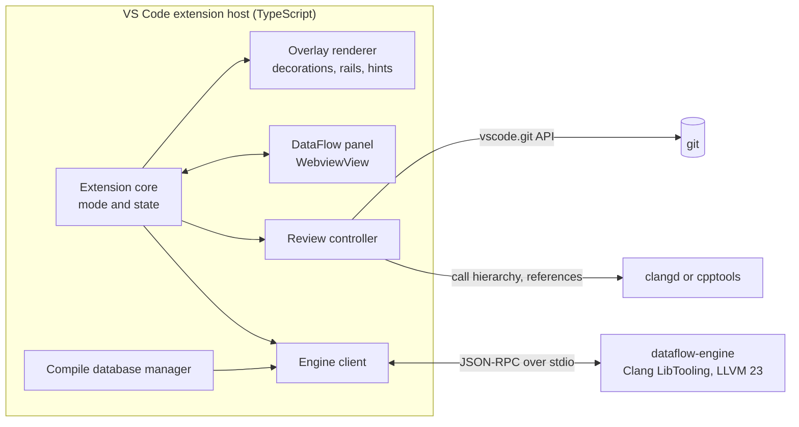

# DataFlow v1: implementation strategy

- Date: 26 October 2026
- Status: proposal. Phase P0 is complete, see [p0-spike-results.md](p0-spike-results.md). Phase P1 is complete, see [p1-notes.md](p1-notes.md). Phase P2 is complete, see [p2-notes.md](p2-notes.md). Phase P3 is complete, see [p3-notes.md](p3-notes.md). Phase P4 is complete, see [p4-notes.md](p4-notes.md). Phase P5 is complete, see [p5-notes.md](p5-notes.md). An accepted plan replaces the overlays in the text editor and the sidebar view with a side view, see [side-view-strategy.md](side-view-strategy.md). It changes decisions D1, D7 and D8, and sections 6.2, 6.3 and 6.4. Its phases S0 to S6 come before P6. Phase S6 is complete: the side view replaced the overlays and the sidebar view, see [s6-notes.md](s6-notes.md). The parts of this plan about the overlays and the panel are history.
- Input: the design study DataFlow Visual Prototypes and a sample file of the author. These are not a part of the repository.

## 1. Scope of v1

DataFlow v1 is one VS Code extension with four lenses in one tool:

| Lens | Question that it answers |
| --- | --- |
| Flow Lens | Where does this value come from, and where does it go? |
| Logic Map | What does the code do in this case? |
| Hidden C++ | What does this line cost? |
| Change Ripple | What does this change affect? |

These conditions apply to v1:

- Build systems: CMake and qmake.
- Platforms: Windows x64 first. Linux x64 follows in the same release. This is an assumption, see section 13.
- Animations are on by default.
- A native helper process is permitted. Its size is not a problem.

These items are not in v1: Flow Graph, Replay, a tree-sitter syntax layer, and an index for the full repository.

## 2. Key decisions

| No. | Decision | Choice | Reason |
| --- | --- | --- | --- |
| D1 | Shape of the tool | Overlays in the text editor, plus one DataFlow panel (a `WebviewView`) | Research shows that marks on the code work better than separate graphs. The panel holds the controls and the details. A custom editor replaces the text editor and removes the clangd or cpptools features. |
| D2 | Analysis back-end | An own native engine, `dataflow-engine`, on Clang LibTooling, LLVM 23 | Only LibTooling gives the CFG with destructors, `ExprMutationAnalyzer` and the dataflow model for optional access. The size of the binary is not a problem. |
| D3 | Protocol | JSON-RPC 2.0 over stdio, with the message headers of LSP | The `vscode-jsonrpc` package handles the TypeScript side. `llvm::json` handles the C++ side. |
| D4 | Syntax layer | No tree-sitter in v1 | CMake and qmake can supply `compile_commands.json`. One analysis path gives one set of results and fewer conflicts. |
| D5 | Data across functions | The VS Code commands for call hierarchy and references | These commands work with clangd and with cpptools. v1 does not need an own index. |
| D6 | Path evaluation | In the extension, in TypeScript, on the CFG from the engine | A change of a branch choice gives a result at once, with no request to the engine. |
| D7 | Rails in the editor | One composed SVG gutter icon for each line, with a maximum of 3 lanes. SMIL animation inside the SVG. | VS Code has no API to draw lines between lines. The source control graph of VS Code uses per-line SVG. |
| D8 | Panel UI | Preact, TypeScript and `@vscode-elements/elements`, bundled with esbuild | The bundle is small, and the widgets look like VS Code. The Webview UI Toolkit is archived. |
| D9 | Distribution | One VSIX file for each platform, with the engine binary and the Clang resource headers | VS Code supports platform-specific extensions. Each user downloads only one binary. |

## 3. Architecture



The extension core keeps the state of the tool: the current function, the active lenses, the selected variable, the branch choices, and the review base. The core sends this state to the renderer and to the panel. The renderer and the panel do not keep state of their own.

| Component | Language | Function |
| --- | --- | --- |
| Extension core | TypeScript | Starts the engine. Keeps the state of the tool. Handles commands and settings. |
| Overlay renderer | TypeScript | Draws token colors, gutter rails, hints, dimmed lines and animations with decorations. |
| DataFlow panel | Preact in a webview | Shows the controls and the details of each lens. Sends user actions to the core. |
| Compile database manager | TypeScript | Finds `compile_commands.json` for CMake and qmake projects. Watches it for changes. |
| Review controller | TypeScript | Reads diffs through the git API. Calls the engine for slices. Follows calls across functions. |
| Engine client | TypeScript | Starts and stops the engine process. Sends requests, cancels them, and restarts the engine after a crash. |
| dataflow-engine | C++ | Parses translation units, keeps them in a cache, and calculates the function model. |

## 4. The analysis engine

### 4.1 Process and protocol

The extension starts one engine process for each VS Code window. The engine loads one compile database for each workspace folder.

| Method | Type | Content |
| --- | --- | --- |
| `initialize` | request | Compile database paths and options. The reply gives the engine version, the LLVM version and the capabilities. |
| `textDocument/didOpen`, `didChange`, `didClose` | notification | The text of the open editors, also text that is not saved. |
| `dataflow/functions` | request | The functions in a file, with names and ranges. |
| `dataflow/functionModel` | request | The full model of one function, see section 4.3. |
| `dataflow/slice` | request | A forward slice from changed lines or from a call, with its exits. |
| `$/cancelRequest` | notification | Stops a request that the extension does not need now. |
| `$/progress` | notification | Parse progress for the status bar. |
| `shutdown`, `exit` | request, notification | Stops the engine. |

### 4.2 Workspace and cache

- The engine reads `compile_commands.json` with `clang::tooling::JSONCompilationDatabase`. For a header, `inferMissingCompileCommands` uses the command of a near source file.
- The engine keeps one `clang::ASTUnit` for each open file, with a precompiled preamble. After an edit, a reparse parses only the main file.
- The cache keeps a maximum of 4 translation units. When the cache is full, the engine removes the unit that it used least recently.
- The engine parses on a pool of threads. The default size is half of the logical cores. The engine never uses more than 80% of the cores.
- The engine keeps the function models in a cache. The key is the document version and the function.
- Each request has a time limit. If a request takes longer than its limit, the engine sends a partial result.

### 4.3 Function model

The extension and the panel share these types. The engine writes the same structure as JSON.

```ts
interface FunctionModel {
  id: string;                // USR of the function
  name: string;
  range: Range;
  partial: boolean;          // true if the AST of the function has errors
  cfg: { blocks: Block[]; entry: number; exit: number };
  decisions: Decision[];     // if, loop, switch and ternary, with their true and false successors
  variables: Variable[];     // parameters, locals and statics, with type and storage
  refs: Ref[];               // each reference to a variable, with its role
  defUse: Edge[];            // reaching definitions: from a definition ref to a use ref
  findings: Finding[];       // for example an unchecked optional access
  implicitOps: ImplicitOp[]; // copies, moves, conversions, temporaries, destructors, lookups
  events: EventCall[];       // calls to the configured event functions
  calls: CallSite[];         // call sites, lambdas and async boundaries
}

type Role = 'def' | 'write' | 'mayWrite' | 'read' | 'check';
```

### 4.4 Analyses

| Analysis | Clang feature | Used by |
| --- | --- | --- |
| Control flow graph | `clang::CFG::buildCFG` with `AddImplicitDtors`, `AddTemporaryDtors`, `AddScopes`, `AddLifetime` and `AddInitializers` | Logic Map, Hidden C++, slices |
| Roles of references | An AST visitor and `ExprMutationAnalyzer` | Flow Lens |
| Reaching definitions | An own bit-vector analysis on the CFG | Flow Lens rails, slices |
| Control dependence | `CFGPostDomTree` | Logic Map, slices |
| Optional access | `UncheckedOptionalAccessModel` of the dataflow framework | Flow Lens findings |
| Implicit operations | Visitors for `CXXConstructExpr`, `ImplicitCastExpr`, `MaterializeTemporaryExpr` and `CXXBindTemporaryExpr`, and the destructor elements of the CFG | Hidden C++ |
| Repeated lookups | A structural compare of key expressions with `Stmt::Profile` | Hidden C++ |
| Events | Calls to configured functions that have a string literal argument | Logic Map |
| Calls and async boundaries | Call sites, lambda captures, configured async functions | Change Ripple |
| Slices | A program dependence graph from reaching definitions and control dependence | Change Ripple |

`ExprMutationAnalyzer` finds writes through references, pointers and non-const member calls. The engine gives these writes the role `mayWrite`.

### 4.5 Errors and partial results

Clang continues after a parse error and marks the bad parts with `RecoveryExpr`. The engine analyzes the function and sets `partial` to `true`. The extension shows the result with a gray marker in the status bar.

If no compile command is available for a file, the engine parses with default flags, as clangd does. The extension then tells the user how to add a compile database.

### 4.6 Code style

The C++ code of the engine follows the personal C++ style of the author. It uses std types. LLVM types appear only at the boundary to the Clang API. The comments use STE.

## 5. Compile databases for CMake and qmake

### 5.1 Discovery

The compile database manager looks for `compile_commands.json` in this sequence:

1. The setting `dataflow.compileCommands`. It can name a file or a folder.
2. For CMake, the build folder from the API of the CMake Tools extension (npm package `vscode-cmake-tools`), if that extension is installed.
3. For qmake, `<build folder>/.qtc_clangd/compile_commands.json`, which Qt Creator writes.
4. The workspace root and the folders `build/`, `out/build/*/` and `build-*/`.

If the manager finds more than one file, it asks the user to select one. It keeps the selection in the workspace state. It watches the selected file and tells the engine when the file changes.

### 5.2 CMake

- CMake writes the file when the cache variable `CMAKE_EXPORT_COMPILE_COMMANDS` is `ON`.
- Only the Ninja and Makefile optimizers support this variable. The Visual Studio optimizers ignore it.
- If the file is not available, the extension shows a configure command with Ninja and this variable.

### 5.3 qmake

- Qt Creator writes `<build folder>/.qtc_clangd/compile_commands.json` when the project uses the clangd code model.
- In Qt Creator, the menu item Build › Run Generator › Compilation Database writes the file on request.
- On Linux and macOS, `bear -- make` writes the file during a normal build.
- On Windows with MSVC, DataFlow reads the `Makefile.Release` that qmake writes, and makes the file from it. Spike P0 (b) showed that this works. Qt Creator is the fallback.

### 5.4 Compilers

- MSVC commands use `cl.exe`. The engine detects this and parses in clang-cl mode. Clang finds the MSVC headers through the Visual Studio installation.
- GCC and MinGW commands work with no change.
- Qt projects include files that moc and uic make, for example `ui_*.h`. Build the project one time before the first analysis.

### 5.5 Security

- The engine starts only in a trusted workspace.
- The engine removes flags that load code into the compiler, for example `-fplugin=` and `-Xclang -load`.
- The engine does not run the compiler. It only parses.

## 6. The extension

### 6.1 Modules

| Module | Function |
| --- | --- |
| `engine/client.ts` | Process control, JSON-RPC, cancel and restart |
| `engine/model.ts` | The types of the function model, shared with the panel |
| `cdb/manager.ts` | Find, select and watch compile databases |
| `state/store.ts` | The state of the tool and its change events |
| `lenses/flow.ts`, `logic.ts`, `cost.ts`, `ripple.ts` | Turn function models into overlay specifications and panel data |
| `logic/paths.ts` | Path evaluation on the CFG. Pure functions with unit tests. |
| `render/overlay.ts` | Decoration types, and their application to the visible editors |
| `render/rails.ts` | SVG for the gutter lanes. Pure functions with unit tests. |
| `render/animate.ts` | Animation timers and the reduce-charge rule |
| `review/git.ts`, `review/ripple.ts` | Diff hunks and the ripple pipeline |
| `panel/provider.ts` | The `WebviewView` provider and its messages |
| `webview/` | The panel UI in Preact |

### 6.2 One tool, two surfaces

The editor shows the overlays of the active lenses. The DataFlow panel shows the controls and the details.

- The header of the panel shows the current function and one switch for each lens: Flow, Logic, Cost and Review.
- Below the header, each lens has one section. The section of the lens that the user used last opens.
- A status bar item shows the current function and the active lenses. A click on it opens the panel.

More than one lens can be active at the same time. For example, Logic Map dims the code that the path cannot reach. Flow Lens then draws rails only on the lines that stay visible, and Hidden C++ adds its hints. Each lens has its own decoration types, so the lenses do not overwrite each other.

| User action | Result |
| --- | --- |
| Put the cursor on a variable and push Ctrl+Alt+F (DataFlow: Trace Variable) | Flow Lens selects the variable. |
| Set follow mode to on | Flow Lens follows the variable under the cursor, after 300 ms with no movement. |
| Set a condition to yes, no or any in the panel | Logic Map calculates the path again and dims the code. |
| Run DataFlow: Why Does This Line Run | Logic Map shows the decisions that control the current line. |
| Push Ctrl+Alt+H (DataFlow: Toggle Hidden C++) | The hints come on or go off. |
| Run DataFlow: Review Changes | Change Ripple compares the files with the base ref. |

VS Code does not tell an extension when the user releases a key. CLion shows its hints only while a key is down, but this method is not possible in VS Code. v1 uses a toggle.

### 6.3 Overlay renderer

- Colors: the extension contributes theme colors (`contributes.colors`) for def, read, write, check, warn and async. Each color has a light, a dark and a high-contrast value. Decorations use them through `ThemeColor`.
- Token marks: one decoration type for each role. Each type gets a `Range[]`, which is the fast path of the API.
- Rails: `render/rails.ts` makes one SVG for each line, from the lanes that cross the line. The renderer keeps one decoration type for each SVG pattern. The glyph margin has space for a maximum of 3 lanes. If a variable has more than 3 definitions, the panel shows the full list.
- Pulse: SMIL `<animate>` inside the SVG moves a dot. Each line gets a start delay, so the dot seems to move down the rail. A new selection makes new SVG URLs, so the animation starts again.
- Dimmed lines: a whole-line decoration with `opacity` 0.35.
- Hints: `after` decorations with `contentText`, one decoration type for each category.
- Path walk and ripple wave: discrete steps through `setDecorations`, at a maximum of 10 steps each second.
- Overview ruler: marks for findings and changed lines.
- When the visible editors change, the renderer applies the decorations again. VS Code removes them on a tab switch.
- The diff editor contains two text editors. The renderer decorates the modified side.
- Breakpoints show in a second glyph lane, so they do not hide the rails. Spike P0 (a) showed this.

### 6.4 Animation

- The setting `dataflow.animations` is `on` by default.
- If `workbench.reduceMotion` is `on`, the extension shows no animation.
- Times: the pulse takes 650 ms for each rail. The path walk takes 120 ms for each line. The ripple takes 400 ms for each step.

### 6.5 Settings

| Setting | Default | Function |
| --- | --- | --- |
| `dataflow.compileCommands` | empty | The path to `compile_commands.json` or to its folder |
| `dataflow.animations` | `on` | Animations on or off |
| `dataflow.engine.maxThreads` | half of the cores | Parse threads. The maximum is 80% of the cores. |
| `dataflow.engine.cacheSize` | 4 | Translation units in memory |
| `dataflow.logic.eventFunctions` | `[]` | Functions that send events, for example `fire_transition` |
| `dataflow.logic.nullableFunctions` | `[]` | Functions that can return a null pointer, for example `get_if` |
| `dataflow.cost.categories` | all | The Hidden C++ categories to show |
| `dataflow.cost.minCopyBytes` | 16 | Copies of trivially copyable types of this size or less do not show |
| `dataflow.ripple.asyncFunctions` | a list | Functions that run a callable on a different thread, for example `std::async`, `QtConcurrent::run` and `tf::Executor::async` |
| `dataflow.ripple.baseRef` | `origin/main` | The base of the review diff |
| `dataflow.ripple.maxDepth` | 2 | The number of caller levels that Change Ripple follows |

## 7. The lenses in v1

### 7.1 Flow Lens

- Input: the variable under the cursor, or the variable that follow mode selects.
- Engine data: the references and their roles, the def-use edges, and the findings.
- Editor: token marks for each role. Rails from each definition and each write to its uses. A possible write gets no rail. It shows as a ring on the rails that reach it, because the old value stays. A red dashed rail for a use that has a finding. Hints for findings, for example "optional not checked here". Marks in the overview ruler.
- Panel: the type and the storage of the variable, the number of reads and writes, the definitions, and the findings.
- Members: v1 tracks a variable as one unit. A read of `settings.grid2home` is a read of `settings`. Flow at field level comes in a later version.
- Acceptance scenario 1: on `bestFit` in `initial_power()` of the fixture `battery`, the lens marks line 46 as an unchecked optional access.

### 7.2 Logic Map

- Engine data: the CFG, the decisions, the events and the control dependence.
- Panel: a decision outline. It shows the nested structure of the function, with a switch for yes, no or any on each decision. An else-if chain that compares one value, for example `home_battery_ctl.state`, shows as one control with more choices. A loop has the choices "enter" and "skip".
- Paths: `logic/paths.ts` goes through the CFG from the entry. It follows only the chosen successors, and both successors for "any". The result is the set of reachable statements, with their events, returns and calls.
- Editor: dims the lines that the path cannot reach. Marks the events. Animates the path walk.
- Warnings: more than one event on one path. A dereference of a pointer that comes from a function in `dataflow.logic.nullableFunctions`, if no null check on the path protects it.
- Why does this line run: the panel lists the decisions that control the current line, with the value that each decision needs. P3 uses dominators for this list, not control dependence. A decision on each path to the line needs a value if only one branch can reach the line. Control dependence gives also the conditions of other paths to a line after a join.
- Acceptance scenario 2: in `process()`, the choices METER_READING, new readings found and timeout show the events `_measured` and `_timeout`, and the warning for two events. The choices CHARGE_PLANNING, converged and POWER_AUTO show the warning on line 109 of the fixture `battery`. It was line 105 until P5 added the async call to `process()`.

### 7.3 Hidden C++

| Category | Source | Rule against noise |
| --- | --- | --- |
| Copies | Copy constructors and copy assignments | Trivially copyable types of `minCopyBytes` or less do not show. Qt types with implicit sharing, for example `QString` and `QList`, show as "shared copy". |
| Moves | Move constructors and move assignments | They show only when copies show. |
| Conversions | `ImplicitCastExpr` that changes the value: integral to floating, floating to integral, narrow integral casts, user-defined conversions | Casts that do not change the value do not show, for example `LValueToRValue` and `NoOp`. |
| Temporaries and lifetime | `MaterializeTemporaryExpr`, references to temporaries, shadowed names | None |
| Destructors | Destructor elements of the CFG at the end of a scope | Only types with a non-trivial destructor show. |
| Allocations | `new`, `std::make_unique`, `std::make_shared`, and a list of known growth calls such as `push_back` and `reserve` | This category is a heuristic. The panel marks it as such. |
| Repeated lookups | Two or more lookups on the same container with keys that are structurally equal, and no write to the container between them | None |
| Hidden state | Static local variables, and globals that the function writes | None |

- Editor: `after` hints in the color of the category. Ctrl+Alt+H turns them on and off.
- Panel: a switch for each category, and a list of the items. Each item has a "Not useful" button. It hides that pattern in the workspace.
- Acceptance scenario 3: in `stable_readings()`, the lens shows the static map, the copy of `GridStatus`, 6 lookups with the same key, and the shadowed `taps`. The 6 lookups are the calls of `operator[]`. The lens also counts the call of `contains`, so it shows 7 lookups: "contains 1, [] 6".

### 7.4 Change Ripple

The ripple pipeline has these steps:

1. The git API gives the changed files and hunks against the base. The base is `dataflow.ripple.baseRef`, or the merge base with it.
2. For each changed line in a C++ file, the engine finds the statement and the function. A deleted line maps to the next statement in the new version.
3. The engine calculates a forward slice in the function from these statements. The slice follows data dependence and control dependence.
4. The engine classifies the exits of the slice: return value, write to a member or a global, write through a reference parameter, call argument, lambda capture, and async call.
5. For a return value, the extension finds the callers with `vscode.prepareCallHierarchy` and `vscode.provideIncomingCalls`. In each caller, the engine continues the slice from the call expression. `dataflow.ripple.maxDepth` sets the limit.
6. For a call to a function in `dataflow.ripple.asyncFunctions`, the slice continues from the result of the call. The step gets the mark "async".
7. For a member write, the slice continues at the reads of the same member in the same function. These steps get the mark "estimated", because the read can occur in a later call.

Each step has a confidence level: "exact" for dependence in one function, "call" for a step through the call hierarchy, and "estimated" for member state and async models.

- Panel: the changed functions. For each change, a ripple tree with its steps and facts: the number of functions, the async boundaries and the exits.
- Editor: a wave animation over the lines that the change reaches, and marks in the overview ruler. This also works in the diff editor.
- If no call hierarchy provider is active, Change Ripple stays in one function. The panel tells the user to install vscode-clangd or cpptools.
- Acceptance scenario 4: for the change from `1e-5` to `1e-4` on line 69 of the fixture `battery`, the ripple reaches lines 70 and 77, the async call on line 95, and lines 102, 104 and 109. The test uses a git copy of the fixture with the branches `main` and `review`.
- P5 changes some steps of the pipeline. Step 2: a deleted block brings the later uses of the variables that it writes, not the next statement. Step 5: the engine also finds the callers in the same file, so Change Ripple does not stay in one function without a call hierarchy provider. [p5-notes.md](p5-notes.md) gives the reasons.

## 8. Repository layout

```text
DataFlow/
  package.json              extension manifest
  src/                      extension in TypeScript
    engine/ cdb/ state/ lenses/ logic/ render/ review/ panel/
  webview/                  panel UI in Preact
  engine/                   dataflow-engine in C++, built with CMake
    src/ tests/
  test/
    fixtures/battery/       small CMake project for the acceptance scenarios
    fixtures/qmake-msvc/    compile database with cl.exe commands
    suite/                  integration tests for @vscode/test-cli
  docs/
```

## 9. Tests

- Engine unit tests: GoogleTest.
- Engine golden tests: for each fixture function, the engine writes the model as JSON. The test compares it with a stored file. A flag writes new stored files after a planned change.
- Extension unit tests: mocha in Node.js, with no VS Code. They cover `logic/paths.ts`, `render/rails.ts`, the diff hunk parser, and the ripple pipeline with a fake engine.
- Integration tests: `@vscode/test-cli` opens the fixture workspace, waits for the engine, runs the commands, and reads the decorations through a hook that the extension exports in test mode.
- Acceptance tests: the four scenarios of section 7, on the fixture project `battery`. It is a small charge controller with stub headers.
- Real code: the author uses the beta on a real project.

| Measurement | Budget |
| --- | --- |
| First analysis of a typical Qt translation unit | less than 5 s |
| Reparse after an edit | less than 500 ms |
| Function model from the cache | less than 50 ms |
| Lens update after a click | less than 100 ms |
| Change Ripple for one change, depth 2 | less than 3 s |

## 10. Build, CI and release

- LLVM 23: use the prebuilt release archives that contain the libraries, for Windows x64 and Linux x64. Link the engine statically.
- zlib 1.3.2 and zstd 1.5.7: build them as static libraries. The LLVM release for Windows needs them, but does not contain them.
- Engine: CMake and Ninja make `dataflow-engine` and copy the Clang resource headers into `lib/clang/23/include`.
- Extension: esbuild bundles `src/` and `webview/`.
- CI: GitHub Actions with a matrix for Windows and Linux. Each job builds the engine, runs all tests, and makes the VSIX with `vsce package --target win32-x64` or `--target linux-x64`.
- LLVM upgrades: one time for each LLVM major release, about every 6 months. The golden tests show the changes.
- Licenses: LLVM uses Apache-2.0 with LLVM exceptions. Each VSIX contains the license files.
- This folder is not a git repository now. Start git before phase P1.

## 11. Phases

| Phase | Content | Exit criteria | Size |
| --- | --- | --- | --- |
| P0 Spikes | (a) Animated SVG in the glyph margin of VS Code, with 3 lanes and a breakpoint on the same line. (b) Engine skeleton: load a CMake database and a qmake database with MSVC commands, parse a file, send the CFG as JSON. (c) `UncheckedOptionalAccessModel` finds the `bestFit` case. | All three spikes work, or this plan changes. | 1 to 2 weeks |
| P1 Foundation | Engine protocol, cache and threads. Engine client. Compile database manager. Overlay renderer with theme colors. Panel with the four sections. Status bar item. | The panel shows the function under the cursor in the CMake fixture and in the qmake fixture. | 3 weeks |
| P2 Flow Lens | Roles, reaching definitions, optional findings, rails, pulse, follow mode. | Acceptance scenario 1 passes. | 2 to 3 weeks |
| P3 Logic Map | Decisions, path evaluation, dispatch groups, events, dimmed lines, path walk, "why does this line run". | Acceptance scenario 2 passes. | 3 weeks |
| P4 Hidden C++ | Implicit operations, lookups, destructors, categories, rules against noise, "Not useful". | Acceptance scenario 3 passes. | 2 to 3 weeks |
| P5 Change Ripple | Git diff, slices, exits, call hierarchy, async and member steps, ripple panel, wave. | Acceptance scenario 4 passes. | 3 to 4 weeks |
| P6 Release | Performance budgets, error states, user docs, VSIX for each platform, beta on real code. | The budgets are met. The beta feedback is closed. | 2 weeks |

The total is about 16 to 20 weeks for one developer. This is an estimate.

## 12. Risks

| Risk | Effect | Mitigation |
| --- | --- | --- |
| Animated SVG does not animate in the glyph margin | No smooth pulse | Closed in P0: SMIL animation works in VS Code 1.124 and 1.143. |
| Breakpoints and rails share the glyph margin | None | Closed in P0: VS Code shows breakpoints in a second glyph lane. |
| The LibTooling API changes in each LLVM release | Upgrade work two times each year | Pin LLVM 23. Keep the Clang code in one module. The golden tests show the effect. |
| No compile database for qmake on Windows | No semantic data | The DataFlow Makefile reader, tested in P0. Qt Creator as a fallback. |
| Clang does not parse some MSVC code | Partial results | clang-cl mode. Tests on the real code base in P0. |
| Long parse times with Eigen and Qt headers | The first result is slow | Preamble cache. The current function first. Progress in the status bar. |
| Too many hints or false findings | Users turn the tool off | Conservative defaults, the "Not useful" button, and marks for heuristics. Target: less than 10% "not useful". |
| `ExprMutationAnalyzer` reports reads as changes | Flow Lens shows reads as possible writes | P2 changes accessor reads, calls of format functions and returned copies to reads. Each new case needs a rule and a test. |
| No call hierarchy provider | Change Ripple stays in one function | Detect this, and tell the user. |
| Two parsers run: clangd or cpptools, and the engine | More CPU and memory | Thread limit, cache limit, and analysis only on request and for visible functions. |

## 13. Open questions

| Question | Assumption in this plan |
| --- | --- |
| Which platforms must v1 support? | Windows x64 and Linux x64. macOS later. |
| Do you use clangd or cpptools for language features? | Both supply the call hierarchy. The plan works with each of them. |
| Which functions send events in your code, other than `fire_transition`? | Only `fire_transition`. The setting adds more. |
| Which base branch do reviews use? | `origin/main` |
| Where is the repository hosted? | GitHub, with GitHub Actions for CI |
