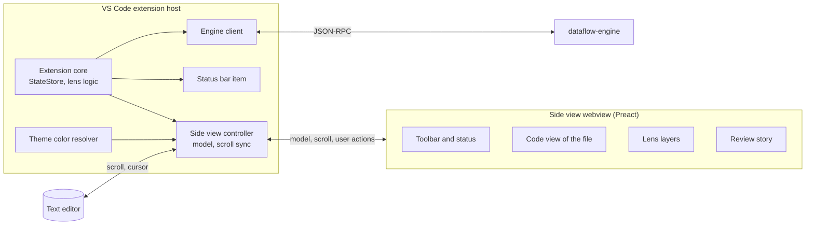

# DataFlow side view: implementation strategy

- Date: 26 October 2026
- Status: accepted. The user chose the decisions of section 10 on 26 October 2026. Phase S0 is complete: esbuild 0.28 bundles the scripts of the sidebar view and of the side view, and the side view uses Preact 11. Phase S1 is complete: [s1-notes.md](s1-notes.md) gives the result. Phase S2 is complete: [s2-notes.md](s2-notes.md) gives the result. After phase S2, the user decided to continue. Phase S3 is complete: [s3-notes.md](s3-notes.md) gives the result. Phase S4 is complete: [s4-notes.md](s4-notes.md) gives the result. Phase S5 is complete: [s5-notes.md](s5-notes.md) gives the result. Phase S6 is complete: [s6-notes.md](s6-notes.md) gives the result. The side view is the only view of DataFlow.
- Input: option D of [overlay-fallbacks.md](overlay-fallbacks.md), the design study DataFlow Visual Prototypes, and the review of P5 by the user
- Changes: decisions D1, D7 and D8, and sections 6.2, 6.3 and 6.4 of [implementation-strategy.md](implementation-strategy.md)

## 1. Goal and scope

The overlays in the text editor do not show the lenses as well as the prototypes. The rails have a maximum of 3 slots, the hints stop at the edge of the window, and the wave moves in steps. This plan replaces the overlays and the sidebar view with a side view. The side view is a webview next to the text editor. It shows the full file of the active editor, and it scrolls together with the text editor. It draws the lenses on the code with full control of HTML, CSS and SVG, and it contains all controls of DataFlow.

In scope:

- The side view, with its own code view and the syntax colors of the active color theme
- The scroll sync in both directions between the text editor and the side view
- The four lenses in the side view. For a review, Change Ripple shows a story of each change.
- All controls and the status of DataFlow in the side view
- The removal of the overlays and of the sidebar view
- The migration of the current code, the tests and the documentation

Not in scope:

- Edits in the side view. The user edits in the text editor.
- Marks of DataFlow in the text editor. The text editor shows no decorations of DataFlow.
- Flow Graph and Replay. They can use the side view in a later version.
- An HTML review page (option F). The user decided against it.

The engine and the lens logic stay. The side view uses the same models as the overlays.

## 2. Key decisions

| No. | Decision | Choice | Reason |
| --- | --- | --- | --- |
| S1 | Main surface | A `WebviewPanel` in the editor group beside the text editor | It has full control of HTML, CSS and SVG, and it uses only the stable API. The text editor keeps clangd or cpptools. |
| S2 | Text editor | No decorations of DataFlow | The decision of the user. The side view shows each lens one time. The scroll sync keeps the two views together. |
| S3 | Content | The full file of the active C++ editor | The decision of the user. A lens of one function, for example Flow Lens, marks only its function in the file. |
| S4 | Scroll sync | In both directions, as in the Markdown preview of VS Code. A click on a line of the side view moves the cursor of the text editor. | The decision of the user. The two views show the same lines. |
| S5 | Reviews | A story of each change: the diff, then a chain of code cards across functions and files | The decision of the user. A ripple goes across functions and files, and one file cannot show it. |
| S6 | Code view | An own code view in the webview, with the text and the tokens from the engine | Monaco is large, and it needs the theme and a grammar too. Shiki needs the theme and a TextMate grammar, and it does not know the semantic kinds. |
| S7 | Syntax colors | The engine gives a kind for each token. The extension reads the colors of the active color theme and sends a color for each kind. | The decision of the user. A webview gets the colors of the workbench, but not the token colors of the theme. Clang knows the kinds better than a grammar. |
| S8 | Controls | All controls and the status are in the side view. The sidebar view goes away. | The decision of the user. The controls are next to the lens that they change. |
| S9 | Open | The side view opens when the user turns on a lens or runs **DataFlow: Review Changes**. A command, a button in the title bar of the editor and the status bar item also open it. | The decision of the user. Without the sidebar view, the user needs these ways to find the side view. |
| S10 | UI stack | Preact and TypeScript, bundled with esbuild | The side view has many parts and much state. Decision D8 already chose this stack. |
| S11 | State | The extension owns the state, as now. The side view shows a model and sends user actions. | The webview can lose its state when it is hidden. The `StateStore` and the lens logic stay. |
| S12 | Animations | `requestAnimationFrame`, CSS transitions and SVG in the webview | The movement is smooth. The reduce-motion rules stay. |
| S13 | Migration | Lens by lens, behind a setting. At the end, the overlay renderer and the sidebar view go. | The decision of the user. The tests stay green at each step. |

## 3. Architecture

- The side view controller makes one `SideViewModel` from the state, the engine data and the lens logic. It sends the model to the webview after each change.
- The controller syncs the scroll position and the cursor between the text editor and the side view.
- The webview draws the model. It sends user actions back, for example a click on a variable or on a condition.
- The theme color resolver sends a color for each token kind. It sends new colors when the color theme changes.

## 4. Engine

### 4.1 Request `dataflow/tokens`

| Params | Result |
| --- | --- |
| `file`, `first`, `last` | For each line from `first` to `last`: the text and the tokens. Each token has 4 numbers: the column, the length, the kind and the modifier bits. A legend gives the names of the kinds and of the bits. |

- The lines come from the text that the engine parsed. So the text, the tokens and the data of the lenses agree, also during an edit.
- The raw lexer of Clang gives the tokens: keywords, comments, literals, operators, identifiers and preprocessor directives.
- An AST visitor gives the semantic kind of each identifier. The kinds are the semantic token types of VS Code: namespace, class, enum, enum member, type, type parameter, function, method, parameter, variable, property and macro. A field is a property. A dependent name in a template gets its kind from its use.
- The modifiers are the semantic token modifiers of VS Code: `declaration`, `readonly`, `static` and `defaultLibrary`. The color themes do not use modifiers for local and global variables, so the engine does not give them.
- A bracket gets its level of nesting, for the colors of the bracket pairs.
- Columns count UTF-8 bytes, as in the other requests. The extension converts them.
- The engine keeps the tokens of the last parse of each file.
- The side view asks for the visible lines and a margin first. Then it asks for the other lines in parts of 1,000 lines.

### 4.2 Other requests

The other requests stay. Their data is already in lines and columns. Some lens data gets more fields for the side view. Section 6 gives them.

## 5. Extension

### 5.1 Modules

| Module | Function | Status |
| --- | --- | --- |
| `side/controller.ts` | Makes, shows and restores the `WebviewPanel`. Follows the active editor. Syncs the scroll position and the cursor. Sends the model and handles the user actions. | New |
| `side/model.ts` | Makes the `SideViewModel` from the state, the tokens and the lens views. Pure functions. | New |
| `side/sync.ts` | The scroll sync: the line maps and the guard against echoes. Pure functions. | New |
| `side/theme.ts` | Finds the colors of the active color theme for each token kind | New |
| `side/protocol.d.ts` | The messages between the extension and the side view. It takes the data types of `panel/protocol.d.ts`. | New |
| `webview-side/` | The Preact components of the side view | New |
| `statusbar.ts` | A click opens the side view. | Changes |
| `lenses/*.ts`, `logic/paths.ts`, `review/*.ts` | The lens logic | Stays, with more fields in some views |
| `render/overlay.ts`, `render/rails.ts` | The overlay renderer | Goes in phase S6 |
| `webview/panel.ts`, `panel/provider.ts` | The sidebar view | Goes in phase S6 |

### 5.2 Behavior of the side view

- **Open:** the side view opens beside the active editor when the user turns on a lens or runs **DataFlow: Review Changes**. The command **DataFlow: Open Side View**, a button in the title bar of a C++ editor and the status bar item also open it. The text editor keeps the focus.
- **File:** the side view shows the file of the active C++ editor. When the focus goes into the side view or into an editor of a different language, the side view keeps its file.
- **Scroll:** the two views show the same first line. Section 5.4 gives the method.
- **Cursor:** the side view marks the line of the cursor and the current function. A click on a line of the side view moves the cursor of the text editor to that line.
- **No text editor:** if no text editor shows the file, for example with Claude Code in front of the C++ editor, the side view has its own cursor. The cursor starts at the last cursor of the text editor, and a click moves it. The lenses follow it. The places of the lists and of the view tools of the MCP server then move only the side view.
- **Lenses:** a click on a variable traces it. A click on a condition changes its choice.
- **Edit:** after the engine parses the new text, the side view shows the new model. It keeps its scroll position.
- **Restore:** a `WebviewPanelSerializer` restores the side view after a reload of the window.
- **Width:** in a narrow side view, a compact mode hides the long hints, the path timeline and the detail column.

### 5.3 Code view

- One row for each line of the file, with the line number and the token spans. The token spans get the colors of the theme.
- The font comes from the CSS variables `--vscode-editor-font-family`, `--vscode-editor-font-size` and `--vscode-editor-font-weight`. The line height comes from the setting `editor.lineHeight`.
- The rows do not wrap. So each line of the file is one row, and the scroll sync can use line numbers.
- Virtual rows: the view renders only the visible rows and a margin.
- The indent guides and the colors of the bracket pairs use the rules and the settings of the text editor.
- The user can select and copy the text.
- The layers of the lenses go on the code:
  - classes on the token spans, for marks
  - classes on the rows, for backgrounds and dimmed lines
  - elements after the text of a row, for hints and chips
  - an SVG lane at the left, for rails
  - an SVG layer over the text, for curves between tokens. It gets the positions of the tokens from the layout of the spans.
  - a column at the right, for the path timeline of Logic Map
  - hover cards
- A lens of one function marks only its function: the trace of Flow Lens, and the path and the choices of Logic Map. Hidden C++ marks all functions of the file.

### 5.4 Scroll sync

- **From the text editor:** `onDidChangeTextEditorVisibleRanges` gives the first visible line. The controller sends it to the side view, and the side view shows this line at the top.
- **From the side view:** the webview sends its first visible line when the user scrolls, a maximum of one time for each frame. The controller calls `revealRange` with `TextEditorRevealType.AtTop` in the text editor. The text editor keeps some lines above a line that it shows at the top: the maximum number of sticky lines, or `editor.cursorSurroundingLines`. So the controller asks for the line under these lines.
- **Echoes:** a sync from one view makes a scroll event in the other view. After each side applies a sync, it ignores scroll events for a short time. The Markdown preview of VS Code uses the same method.
- Folded regions and wrapped lines in the text editor do not change the method, because the sync uses line numbers.
- The cursor sync is separate. The side view marks the line of the cursor. It scrolls for a change of the cursor only if the line is not visible.

### 5.5 Lens layers

The prototypes of the design study have the look of each lens. Their data is written by hand, and their tokenizer is a regular expression. The side view draws with their methods and with the data of the engine.

| Lens | The side view shows | From the prototypes |
| --- | --- | --- |
| Flow Lens | Marks for each role. A rail for each definition, with no limit of slots. A pulse on each rail. Hints. A hover card for each reference: the role, the definitions that reach it, and the finding. A curve from the definition to the reference under the mouse. The variables of the function in the toolbar. | Rails with round corners, and the pulse along an SVG path, from `p-flowlens.js` |
| Logic Map | Dimmed lines that the path cannot reach. A chip on each condition with the choices. The path timeline beside the code, with a smooth walk. Badges for events and warnings. "Why does this line run" in a hover card on the line number. The decision outline in the detail column. | The path timeline with diamonds for conditions, from `p-logic.js` |
| Hidden C++ | Chips at the end of the lines, in the colors of the categories. A hover card with the detail and the "Not useful" button. A connector between the lookups of a group. The category switches in the toolbar. The items of the function in the detail column. | The chips and hints of `p-hidden.js` |
| Change Ripple | Story mode. A review switches the side view to a story of each change. The diff of the changed lines comes first. Then a chain of code cards follows, with one card for each function or lambda of the ripple. Each card shows the affected lines with some context. Arrows connect the cards at a return to a caller, at a lambda and at an async call. The wave lights the steps in order. The exits are badges at the end of a card. A click on a card opens that place in the file view and in the text editor. A button goes back to the file view. | The diff view and the chain of cards, from `p-ripple.js` |

### 5.6 Toolbar, detail column and status

- The toolbar has a switch for each lens and the controls of the active lenses.
- The detail column at the right shows the lists of the active lens. Examples are the decision outline of Logic Map and the items of Hidden C++. The user can close the column.
- The status line shows the engine, the parse time, the parse errors and the compile database. It has the commands of the sidebar view of today: select the compile database, show the log and restart the engine.

### 5.7 State and messages

- The `StateStore` stays the owner of the state. It gets the state of the side view: open or closed, the file, the mode (file or story) and the first visible line.
- To the side view:
  - the model, and the colors of the token kinds
  - the settings for the font, the animations and the reduce-motion rule
  - the first visible line, and the line of the cursor
- From the side view, the user actions:
  - for all lenses: ready, scroll, select a line, toggle a lens, and go to the file view or to the story
  - for Flow Lens and Logic Map: trace a variable, set a choice, and walk the path
  - for Hidden C++: set a category, not useful, and show the hidden patterns
  - for Change Ripple: review the changes, clear the review, and open a diff
  - for the status: select the compile database, show the log, and restart the engine
- The model contains the lens data of the file. The rows come in parts, as section 4.1 says. A story model contains only the lines of its cards.

### 5.8 Theme colors

1. Find the active theme: the setting `workbench.colorTheme` agrees with the `id` or the label of a theme in `contributes.themes` of an extension. `vscode.extensions.all` contains the built-in themes too. VS Code changes some old ids, for example `Default Dark Modern` to `Dark Modern`.
2. Read the JSON file of the theme. Follow `include`. Accept comments, and a comma after the last item of a list.
3. Find the color of each token kind: a list of TextMate scopes for each kind, and the scope selectors of `tokenColors`. Use `semanticTokenColors` for the semantic kinds.
4. Apply the user settings `editor.tokenColorCustomizations` and `editor.semanticTokenColorCustomizations`.
5. Send the colors again after `onDidChangeActiveColorTheme` and after a change of these settings.

If a step fails, the side view uses colors of the workbench that follow the theme, for example `--vscode-symbolIcon-functionForeground` and `--vscode-debugTokenExpression-string`.

The colors of the indent guides and of the bracket pairs are theme colors of the workbench. The webview reads them from its CSS variables.

### 5.9 Accessibility

- All controls are buttons with labels. The user can reach them with the keyboard.
- A hint or a chip has a text for screen readers.
- The rule for motion stays: no animation if `dataflow.animations` is `off` or `workbench.reduceMotion` is `on`. The webview also obeys `prefers-reduced-motion`.
- In a high contrast theme, marks have borders, not only backgrounds.

## 6. Migration of the current code

| Current part | Change |
| --- | --- |
| `render/overlay.ts`, `render/rails.ts` | Go in phase S6. The rails move into the webview. |
| `lenses/flow.ts` | The view keeps all lanes. The side view needs no assignment of slots. |
| `lenses/logic.ts`, `logic/paths.ts` | The view gets the steps of the path for the timeline. |
| `lenses/cost.ts` | The view gets the detail of each item on a line. |
| `lenses/ripple.ts`, `review/*.ts` | The view gets the chain of cards and the old text of the changed lines. |
| `webview/panel.ts`, `panel/provider.ts`, `panel/protocol.d.ts` | The sidebar view goes in phase S6. Its data types move to `side/protocol.d.ts`. |
| `package.json` | The container in the activity bar and the sidebar view go. New: the command **DataFlow: Open Side View** and a button in the title bar of the editor. |
| `statusbar.ts` | A click opens the side view. |
| `extension.ts` | The calls of the overlay renderer and of the sidebar view go to the side view controller. |
| Tests | The tests read the model of the side view, not `api.overlay` and not the state of the sidebar view. |
| `spikes/ui/*-snapshot.mjs` | New scripts make screenshots of the side view. |

During the migration, the setting `dataflow.view` selects `editor` or `side`. The default is `editor` until phase S5 is complete. Phase S6 removes the setting, the overlays and the sidebar view.

## 7. Phases

| Phase | Content | Exit criteria |
| --- | --- | --- |
| S0 Toolchain | Check `npm install`. The user repaired the Node.js installation. If `npm install` still fails, repair it. Add esbuild and Preact, and bundle the webviews. | `npm install` works. `npm test` passes with the bundled webviews. |
| S1 Side view and code view | The request `dataflow/tokens`, the theme color resolver and the side view controller. The code view of the full file with virtual rows. The scroll sync in both directions, the cursor sync and the restore. The frame of the toolbar and of the status. | The code of the fixture and of TBT looks like the text editor in a dark, a light and a high contrast theme. The two views scroll together with no jumps. The side view renders the visible rows of a file of 2,000 lines in less than 100 ms. |
| S2 Flow Lens | The layer of Flow Lens and its hover cards | Acceptance scenario 1 passes in the side view. Then the user compares the side view with the rails in the gutter and decides to continue or to stop. |
| S3 Logic Map | The layer of Logic Map, the chips on the conditions, the path timeline and the decision outline | Acceptance scenario 2 passes in the side view. |
| S4 Hidden C++ | The layer of Hidden C++, its hover cards and its list of items | Acceptance scenario 3 passes in the side view. |
| S5 Change Ripple | Story mode with the diff, the cards and the arrows | Acceptance scenario 4 passes in the side view. With a call hierarchy provider, the story shows the caller in `main.cpp`. |
| S6 Switch | The side view becomes the only view. Remove the overlays, the sidebar view and the setting. Update the documentation. | All tests pass with the side view. The overlay renderer and the sidebar view are gone. |

The decision after phase S2 is important. If the side view does not read better than the overlays on real code, stop and use option A or option C of [overlay-fallbacks.md](overlay-fallbacks.md).

These phases come before P6. Otherwise, P6 makes the documentation, the screenshots and the VSIX of the overlays, and the side view makes them again.

## 8. Tests

- **Unit tests** of pure functions:
  - the model of the side view, and the conversion of the tokens
  - the resolution of the theme colors
  - the line maps of the scroll sync, and the guard against echoes
  - the layout of the rails and of the review story
  - the order of the wave and of the path walk
- **Acceptance tests:** the test API of the extension gives the last model of the side view. The sidebar view does the same with its state now. The tests of scenarios 1 to 4 read this model.
- **Scroll sync tests:** a test scrolls the text editor and checks the first line that the side view gets. A second test sends a scroll message from the side view and checks the visible range of the text editor.
- **Visual checks:** scripts with the Chrome DevTools Protocol make screenshots of the side view in a dark, a light and a high contrast theme. The side view is a webview target, as the sidebar view is now.
- **Performance:** in the test mode, the webview sends the time of each render. A test compares it with the budget.

| Budget | Value |
| --- | --- |
| Render of the visible rows of a file of 2,000 lines | less than 100 ms |
| Update of the side view after an edit, with the models in the cache of the engine | less than 200 ms |
| Scroll sync | The other view follows in the same frame or in the next frame. |
| Animations | 60 frames each second, with no layout of the page during a frame |

## 9. Risks

| Risk | Effect | Mitigation |
| --- | --- | --- |
| The syntax colors are not the same as in the text editor | The two views look different | The kinds come from Clang. Test with 3 themes. Use the colors of the workbench if the theme file cannot be read. |
| Two views of the same code need space | Less code is visible on a small screen | A compact mode. The user can close the side view. |
| A large file makes the webview slow | Slow updates, scrolls and animations | Virtual rows. Tokens in parts. |
| The scroll sync jumps or makes a loop | The views move by themselves | The guard against echoes. Line numbers, not pixels. Scroll sync tests. |
| The webview loses its state when it is hidden | The view starts again | The extension owns the state and sends the full model when the view is visible again. |
| Without the sidebar view, users do not find DataFlow | The tool looks hidden | The status bar item, the button in the title bar of the editor, and the side view opens with each lens. |
| `npm install` fails again | No new packages | Phase S0 checks it first. |
| The content security policy blocks inline styles | Some effects do not work | Use classes, CSS variables and changes of styles through the DOM. Load scripts only with a nonce. |
| Tests of the DOM of a webview are fragile | Tests fail for no real cause | The tests read the model. Screenshots check the look. |

## 10. Decisions of the user

The user chose these answers on 26 October 2026:

| Question | Choice |
| --- | --- |
| What stays in the text editor? | Nothing. The text editor shows no decorations of DataFlow. |
| What code does the side view show? | The full file of the active editor |
| How do the two views scroll? | Together, in both directions |
| Where are the controls? | Only in the side view. The sidebar view goes away. |
| Which UI stack? | Preact and esbuild. The user repaired the Node.js installation. If `npm install` fails, phase S0 repairs it. |
| How does a review look? | Story mode: the diff, then a chain of code cards |
| Where do the syntax colors come from? | From the engine and the active color theme |
| What happens to the overlay renderer? | It goes in phase S6. |
| When does the side view open? | When the user turns on a lens or reviews the changes |
| Does an HTML review page come later? | No |
