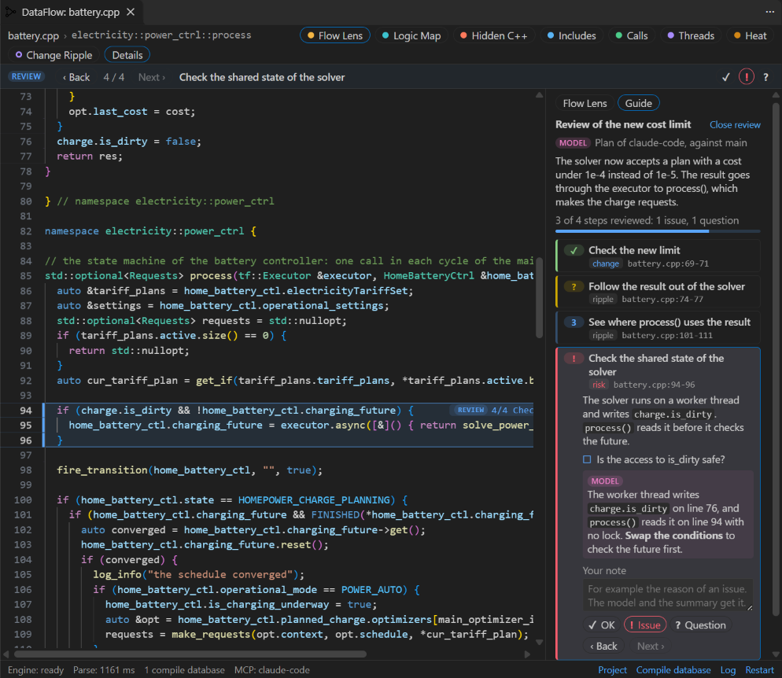
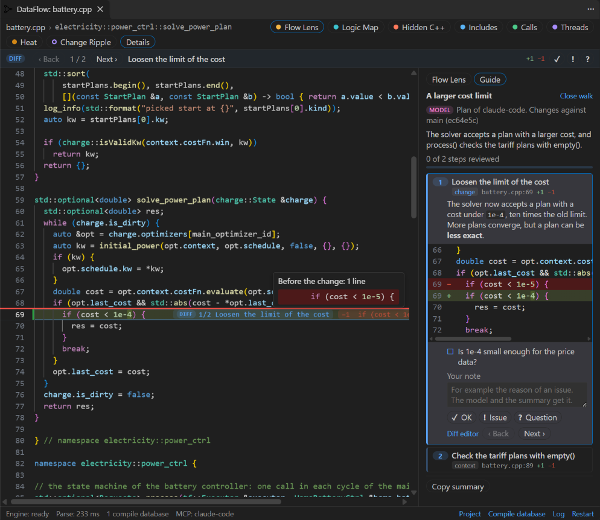

# Use the MCP tools

DataFlow has an MCP server (Model Context Protocol). A language model in an MCP client can read the analysis of the engine and change the side view. Claude Code and the agent mode of VS Code are examples of MCP clients.

The model can show the logical blocks of a function with names and summaries, and start Flow Lens on a variable. It can also color lines with notes, add comments to single lines, and add details to code. The engine gives the facts, and the model adds the words. In a guided review, the model goes through the files that you name with you, one step after the other. In a diff walk, the model or DataFlow goes through the changes of a diff with you. The side view shows the diff of each step.

The model can also read and show the paths of Logic Map, run Change Ripple, turn the lenses on and off, and move the cursor to a line. Other VS Code extensions can use the same tools through the [API for extensions](api.md).

- [Connect Claude Code](#connect-claude-code)
- [Connect a different client](#connect-a-different-client)
- [Ask the model](#ask-the-model)
- [What the side view shows](#what-the-side-view-shows)
- [Guided review](#guided-review)
- [Diff walk](#diff-walk)
- [The tools](#the-tools)
- [Security and privacy](#security-and-privacy)
- [Settings](#settings)

## Connect Claude Code

This method needs no MCP setup.

1. Run **DataFlow: Connect to Claude Code**. If the Claude Code extension is installed, DataFlow also asks you one time when it starts. Then click **Connect**.
   - **Not now** asks you again after 7 days.
   - **Do not ask again** stops the question.
2. Start a new Claude Code session: in the panel of the Claude Code extension, in a terminal, or in the desktop app. Claude Code gets the tools of DataFlow in all projects and windows.
3. Ask Claude Code about the code. [Ask the model](#ask-the-model) gives examples.

Claude Code has no interface for other extensions. Thus DataFlow uses two documented settings of Claude Code in `~/.claude/settings.json`:

- `extraKnownMarketplaces` gets the marketplace `dataflow-vscode`. This marketplace is a local folder that DataFlow writes: `.dataflow/mcp/claude` in your home folder.
- `enabledPlugins` turns on its plugin `dataflow@dataflow-vscode`.

The other keys of the file stay as they are. If `CLAUDE_CONFIG_DIR` moves the settings of Claude Code, DataFlow uses the same folder.

The plugin has one MCP server, `plugin:dataflow:dataflow`, so the tools have names such as `mcp__plugin_dataflow_dataflow__get_view`. The server is the bridge of DataFlow. VS Code itself runs the bridge as Node.js, so you need no Node.js. The bridge reads the token from a file in `.dataflow/mcp` that only you can read.

After a reload of the VS Code window, for example with a new version of DataFlow, the bridge tells Claude Code that the tools changed. Then Claude Code gets the new tools. A bridge of an older version of DataFlow does not do this, so start a new Claude Code session one time.

While the connection is on, the MCP server of each window starts with DataFlow. If you turn off the plugin in Claude Code, DataFlow does not turn it on again.

To remove the connection, run **DataFlow: Disconnect from Claude Code**. The command removes the two keys, the plugin folder and the token file. DataFlow then does not ask you again.

## Connect a different client

1. Start the server. Use one of these methods:
   - Run **DataFlow: Start MCP Server**. The server runs until the window closes.
   - Set `dataflow.mcp.enabled` to `true`. The server starts each time that DataFlow starts.
   - The agent mode of VS Code starts the server when it needs it. VS Code shows DataFlow in its list of MCP servers, and you agree to the start there.
2. Run **DataFlow: Copy MCP Setup**, and select a setup. The command puts the setup on the clipboard.
   - **Claude Code: connect with no setup** does the same as **DataFlow: Connect to Claude Code**.
   - **Claude Code: all projects and windows** gives a command for a terminal. Paste it and push Enter. Claude Code then starts the bridge of DataFlow, a small Node.js program. The bridge sends the messages to the VS Code window that has the folder of Claude Code. Thus one setup works for all projects and all windows. The command has this form:

     ```bash
     claude mcp add --transport stdio --scope user --env DATAFLOW_TOKEN=<token> dataflow -- node "C:\Users\<user>\.dataflow\mcp\bridge.js"
     ```

   - **Claude Code: this window only** gives a command with the address of the server of this window:

     ```bash
     claude mcp add --transport http dataflow http://127.0.0.1:47321/mcp --header "Authorization: Bearer <token>"
     ```

   - **JSON for a client that starts programs** gives the server for the configuration file of a client, for example `claude_desktop_config.json` of Claude Desktop. If no window has the folder of the client, the bridge uses the window that had the focus last.
3. For a different client with HTTP, give it the address and the header of the setup **Claude Code: this window only**. The agent mode of VS Code needs no setup.

The bridge of these setups needs Node.js on the `PATH`. DataFlow copies the bridge into the folder `.dataflow/mcp` of your home folder, so an update of DataFlow does not change the setup. While the server of a window runs, the window keeps a file there with its address and its folders. The file has no token.

Each VS Code window has its own server. If the port is in use, for example by a different window, the server takes a free port. The bridge finds the server of each window. A setup with an address goes only to the window of that address. The status line of the side view shows **MCP** and the name of the client that connected last.

## Ask the model

Ask the model about the code in words. The model selects the tools. These are examples:

- "Explain process() in logical blocks, and show me what happens to charge.is_dirty."
- "Mark the lines of process() that can fail, and tell me why."
- "Add a short comment to each line of process() that is hard to read."
- "Give examples for the selected expression." First, select the expression in the side view or in the editor.
- "Can two threads use the same data in this file at the same time?"
- "Do a guided review of src/power and include/power/plan.hpp."
- "Remove your notes from the side view."

The server also has the prompt **explain-function**. It tells the model the steps to explain a function in logical blocks. Its argument `function` is optional. The default is the function at the cursor. The prompt tells the model to do these steps:

1. Call `get_structure` for the function. With no function, call `get_view` first to find the file and the function.
2. Put the statements into 3 to 8 logical blocks. An if chain on a state can get one child block for each branch, and a long branch can also get child blocks.
3. Call `show_blocks`.
4. Explain the function in some short paragraphs, with the ids of the blocks.
5. Add comments to lines that are hard to read, and details to expressions that need a longer explanation.

The server also has the prompt **guided-review**. It tells the model the steps of a guided review of the files and the folders in its argument `paths`. The optional argument `focus` tells the model what to look at first, for example threads or error handling. [Guided review](#guided-review) tells more.

The server also has the prompt **diff-walk**. It tells the model the steps of a diff walk. The optional argument `base` gives the changes: `uncommitted` (the default), `target` or a commit. The optional argument `focus` tells the model what to explain first. [Diff walk](#diff-walk) tells more.

## What the side view shows

The layers of the model show in the side view:

- **Blocks**: each block has a bar next to the line numbers. A child block, for example a branch of an if chain, has a second bar, and each level after it has one more bar. The blocks have a maximum of five levels. The title of a block shows after the code of its first line.
- **Notes**: a note of the model colors its lines: red for a problem, orange for a warning, and pink for information. The note shows after the code of the first line.
- **Comments**: a comment of the model shows after the code of its line, with a star. It does not color the line. A comment has the color `dataflow.modelComment`, or a color that the model selects: blue, green, purple, yellow, orange, red or gray. These colors are the chart colors of your color theme.
- **Details**: a detail of the model is a longer explanation or examples for a part of the code. The first line of the code gets a symbol **i** at its end. On a long line, the symbol stays at the right edge of the side view. To see the detail in a card, move the mouse on the symbol. Thus the detail takes no space in the view. While the card shows, the code of the detail gets a background. To see the card at the cursor, push Ctrl+Alt+K. The text can have lists, code and bold text.

To get a detail, select code in the side view or in the editor. Then ask the model, for example "give examples for the selected expression".

The bar **MODEL** under the toolbar shows the blocks, the note and the comment at the cursor. On a long line, the titles, the notes and the comments can be out of the visible part of the side view. This bar always shows them. Out of a block, the bar shows the number of blocks of the function at the cursor, or the number of functions with blocks.

The tab **Model** of the details column uses the cursor:

- It lists the blocks of the function at the cursor with their summaries. Each block shows the data that goes in and comes out, and the exits, thread starts, events and calls.
- It also lists the notes, the comments and the details of that function.
- If more than one function has blocks, the tab shows a link for each of these functions. To go to the first block of a function, click its link.
- To go to the line of a block, a note, a comment or a detail, click it. A detail also opens its text.
- With the cursor out of a function, the tab lists the notes, the comments and the details of the file.

A badge **MODEL** marks each title, summary, note and detail of the model, and a star marks each comment. The lines and the data come from the engine.

To hide the layers of the model in the code, click **Model** in the toolbar of the side view. To show them again, click it again. The command **DataFlow: Show or Hide Model Layers** does the same. The layers stay, and the tab Model still lists them. A new call of a view tool shows the layers again.

To remove the blocks, the notes, the comments and the details of all clients in the file, click **Remove model layers** in the tab Model, or run **DataFlow: Remove Model Layers**.

Each client has its own layers. A client is an MCP client, for example Claude Code, or an extension that uses the [API for extensions](api.md). The view tools of a client change only the layers of that client. If two clients or more have layers in a file:

- The bars of the blocks of each client stand side by side. The bars of the first client have the color of the model. The bars of the next clients have the chart colors of your color theme: blue, green, orange and yellow.
- In the code, the ids of the blocks start with the name of their client, for example `claude-code:2a`.
- The tab Model shows one group for each client. The card of a detail shows the name of its client.

An extension can also put buttons on its notes, its details and the steps of its guide. The buttons show in the bar MODEL, in the tab Model, in the card of a detail and in the tab Guide. A click on a button goes to the extension. If the extension is not active, the status bar tells you.

During an edit, the layers move with their code:

- A block, a note, a comment or a detail whose lines you delete goes away.
- A detail finds its code again after an edit in its line.
- A change that replaces the text from its start to the last line of the layer removes all layers.
- After a reload of the window, the layers come back. Each layer goes to the nearest place where its first and its last line have the same text as before. A block whose lines changed goes away with its child blocks.

The model can show blocks for each function of a file at the same time. A call of `show_blocks` replaces only the blocks of its function, and each function has its own block ids. If two functions have a block with the same id, a note on that block also gives the function. Two overloads of a function have the same name, so for a block of an overload, a note gives the lines of the block.

The model gives each block as a range of lines. DataFlow moves each range to whole statements. A block of the function covers the statements of the body that its lines touch. A child block covers the branches or the statements in its parent. If the parent is one if statement with no else, the child blocks cover the statements of that if. If blocks overlap after the move, the view does not change, and the model gets the reason.

DataFlow calculates the data that goes into each block and comes out of it:

- "In" is a name that the block reads and does not set before the read.
- "Out" is a name that the block writes and that a read outside of the block can get through the control flow. The read can be after the block, or in the next turn of a loop. A write that each path writes again before the read is not "out".
- A member, a global and a field of a parameter are always "out".
- For a write through an element of a container, "out" uses the reads of the container. Thus it can contain a write that each path writes again.
- For a write of a captured variable in a lambda, a later line that reads the name counts. The reason is that the reads are in the function that contains the lambda.

## Guided review

In a guided review, the model makes a plan to review the files and the folders that you name. The side view shows the plan one step after the other. Each step shows its lines in the code, a text with what to look at and why, and the questions that you answer.



### Start a guided review

Ask the model for a review of files or folders, for example "Do a guided review of src/power and include/power/plan.hpp". You can also use the prompt **guided-review** of DataFlow with the paths. In Claude Code, type `/` and select the prompt.

The model does these steps:

1. It calls `get_review` with the paths. DataFlow gives the C and C++ files under the paths. If the git repository has a target branch, a changed file also has its diff against the merge base, and the heat of its changed functions. Change Ripple does not run, and the side view does not change.
2. It reads the code with the read tools, for example `get_structure` and `get_flow`.
3. It calls `show_review_plan` with the steps. The plan starts with the hottest changes, unless a different order explains the change better. The side view goes to the lines of step 1.
4. It explains step 1, and waits for you.

### Go through the steps

- The bar **REVIEW** under the toolbar shows the number and the title of the current step. To go to a different step, click **Next ›** or **‹ Back**. The side view goes to the lines of the step. If a C++ text editor shows, it also goes to the lines. To open the tab **Guide**, click the title.
- The lines of the current step have a blue background, and a tag with the number and the title of the step.
- The tab **Guide** of the details column shows the plan: the title, the summary of the model, your progress, and each step with its kind and its place. The current step also shows its text, its questions and the note of the model. To go to a step, click it.
- While the lens **Heat** shows, each step in the tab Guide also shows the flames and the score of its hottest function. To see the name of the function, move the mouse on the flames.
- To mark a step, click **OK**, **Issue** or **Question** in the bar or in the tab Guide. To remove the mark, click it again.
- The current step in the tab Guide has the field **Your note**. Write a note for the model there, for example the reason of an issue. DataFlow keeps the note when the field loses the focus, or when you push Ctrl+Enter.
- Ask the model about the current step, or ask for the next step. The model reads the current step, your marks and your notes with `get_view`. With `review_step`, it goes to a step and adds its answer or a finding as a note.
- To put the summary of the review on the clipboard, click **Copy summary**. The summary is Markdown, for example for a comment on a pull request. It has each step with its place, its mark, the note of the model and your note.
- To remove the guide, click **Close review**, or ask the model to close it. The guide under it then shows again.

A step can be in each text file of the project, for example `CMakeLists.txt`, a `.ui` file or a `.qml` file. The side view shows only C and C++ files. Thus such a step opens its file in the text editor beside the side view, and the side view keeps its file. The tab Guide marks the step with **text editor**. A step can also be in a new file that is not there yet. Such a step opens no editor, and the tab Guide marks it with **new file**. When the file is there, the step opens it.

A model or an extension can give a step a short label, for example the risk of the step. The tab Guide shows the label next to the title.

These commands do the same as the buttons: **DataFlow: Next Guide Step**, **DataFlow: Previous Guide Step**, **DataFlow: Copy Guide Summary** and **DataFlow: Close Guide**. They show in the Command Palette while a guided review or a diff walk shows. You can give them keys in the keyboard shortcuts of VS Code.

During an edit, the steps move with their code, in each text file. After a reload of the window, the guides come back at the same step with your marks and your notes. Each step goes to the nearest place where its first and its last line have the same text as before.

### More than one guide

The side view keeps a stack of up to 5 guides: the guided reviews and the diff walks of you, of the model and of extensions. The top guide shows. A new plan goes on the top, and the guides under it stay. When the top guide closes, the guide under it shows again at its step.

- The tab Guide names the guides under the top guide, for example "Under this guide: Review of the new limit (claude-code)". To bring a guide to the top, click its name.
- Each guide has an id, for example g3, and an owner. You are the owner of a walk of the command **DataFlow: Walk Through the Changes**. Else the owner is the client that made the guide.
- A model changes or closes a guide of a different owner only when you ask it for it. To change its own plan, the model gives the id of the plan, and the new plan replaces the old plan at its place in the stack.
- With 5 guides in the stack, a new guide fails. Close a guide first.

The color of the guide is the theme color `dataflow.reviewGuide`. The default is the blue of the chart colors of your color theme.

## Diff walk

A diff walk goes through the changes of a diff with you, one step after the other. Each step has the changes of one function, or of one part of a file. The side view marks the changed lines of the current step in the code. The tab **Guide** shows the diff of the step with a text.



### Start a diff walk

You can start a diff walk in two ways:

- Run **DataFlow: Walk Through the Changes**, and select the changes. DataFlow makes one step for each changed function, in the sequence of the files and the lines. The text of a step gives the number of added and removed lines.
- Ask the model to walk you through the changes. Examples are "Walk me through the changes that you made" and "Walk me through the changes of this branch". For the changes against a different branch, name the branch, for example "Walk me through the changes against develop". You can also use the prompt **diff-walk** of DataFlow. The model puts the changes in the sequence that explains them best, and each step tells what changed and why.

The changes come from one of these diffs. Each diff goes to the working tree, with the text of the editors that is not saved. The C and C++ files that git does not track yet are new files.

| Changes | Base of the diff |
| --- | --- |
| Changes that are not committed | HEAD |
| Changes of the branch | The merge base of HEAD and the target branch of Change Ripple, for example main |
| Changes against a branch | The merge base of HEAD and a local or a remote branch that you select in a list |
| Changes since a commit | The merge base of HEAD and a commit, a tag or a branch that you type, for example HEAD~1 |

The model does these steps:

1. It calls `get_diff`. DataFlow gives the hunks of the changed C and C++ files. Each hunk has an id, for example h3, the functions that it changes, and their heat. The model gives the hottest changes an early step.
2. It reads the changed code with the read tools, for example `get_structure` and `get_flow`.
3. It calls `show_diff_walk` with the steps. Each step names its hunks. DataFlow adds a step at the end for each hunk that no step names. The side view goes to step 1.
4. It explains step 1, and waits for you.

### Go through the changes

A diff walk has the bar, the tab Guide, the marks and the commands of the guided review. The bar shows **DIFF**. These items are different:

- The added lines of the current step have a green background. In a changed line, the changed characters have a darker green.
- A red line is at the place of removed lines. A chip after the code gives the first removed line, or the number of removed lines. To see the removed lines, move the mouse on the chip.
- The changes of the other steps in the file have a mark next to the line numbers.
- The current step in the tab **Guide** shows its diff, with the lines around the changes. To show a line in the code, click it. To open the diff editor of VS Code at the lines of the step, click **Diff editor**.
- Each step gives its number of added and removed lines, for example +3 −1.
- While the lens **Heat** shows, each step also shows the flames and the score of its hottest function, as in the guided review.

During an edit, the steps and their marks move with their code, but the diff of a step does not change. To see the new changes, start the walk again.

To remove the walk, click **Close walk** in the tab Guide, or ask the model, for example "Close the diff walk".

The side view shows only C and C++ files. The summary of a walk of the command gives the deleted files, and the changed files that are not C or C++ files. With `allFiles`, `get_diff` also gives the changes of the text files that are not C or C++ files, for example `CMakeLists.txt`. Then a step of such a file opens in the text editor, as in a guided review. The command **DataFlow: Walk Through the Changes** shows only C and C++ files.

## The tools

The read tools give the facts of the engine and of git, and do not change the view. The view tools change the side view.

Other extensions can add their own tools to the server with the [API for extensions](api.md#tools-for-the-mcp-server). The name of such a tool starts with the name of the extension, for example `my_extension_get_brief`, and its description starts with the name of the extension too. After a change of these tools, the bridge tells Claude Code that the list of the tools changed.

| Tool | Kind | Function |
| --- | --- | --- |
| [`get_view`](#get_view) | read | The active file, the function and the line at the cursor, and the selection. Also the state of the side view, with the blocks of each function. With no C++ editor, the file, the cursor and the selection of the side view |
| [`list_functions`](#list_functions) | read | The functions of a file with their lines |
| [`get_structure`](#get_structure) | read | The statements of a function with their lines, the branches, the data in and out, and the exits, thread starts, events and calls |
| [`get_flow`](#get_flow) | read | The trace of a variable or a data member, without a change of the view. For a member also the threads, the locks and a verdict about races |
| [`get_calls`](#get_calls) | read | The data of Call Hierarchy |
| [`get_callers`](#get_callers) | read | The callers of a function in all files of the project, from the call graph, and its frame paths |
| [`get_place`](#get_place) | read | The facts of a line: the function, the loops and the decisions around the line, the locks, the threads and the frame path |
| [`get_threads`](#get_threads) | read | The data of Threads and races |
| [`get_hidden`](#get_hidden) | read | The data of Hidden C++ |
| [`get_includes`](#get_includes) | read | The data of Include Hierarchy, with the translation units of the compile database that include the file |
| [`get_outline`](#get_outline) | read | The outline of a type: the members, the annotations and the memory layout |
| [`get_heat`](#get_heat) | read | The heat score of each function of a file: how much a change of the function can break, with the reason of each point |
| [`get_call_graph`](#get_call_graph) | read | The state of the scan of the call graph, and the frame functions of the project |
| [`get_logic`](#get_logic) | read | The data of Logic Map: the decisions of a function with their options, and one path through the function for the choices |
| [`get_ripple`](#get_ripple) | read | The data of the last review of Change Ripple: the code that each change reaches, also in the callers |
| [`get_review`](#get_review) | read | The C and C++ files under the paths of a guided review, with the diff of each changed file against the target branch |
| [`get_diff`](#get_diff) | read | The hunks of the changed C and C++ files against a base, with their functions and their diff, for a diff walk. With `allFiles`, also the other changed text files |
| [`show_blocks`](#show_blocks) | view | Shows the logical blocks of a function, with a maximum of five levels. A new call replaces the blocks of its function. The blocks of the other functions of the file stay. |
| [`show_flow`](#show_flow) | view | Starts Flow Lens on a variable or a data member, as a click does |
| [`show_logic_path`](#show_logic_path) | view | Shows Logic Map for a function with a path for the choices |
| [`show_line`](#show_line) | view | Moves the cursor to a line, and shows the line |
| [`highlight`](#highlight) | view | Colors ranges of lines or blocks, with a note for each range |
| [`comment_lines`](#comment_lines) | view | Adds a short comment to single lines, in the color of the comments or in a color of the model |
| [`add_detail`](#add_detail) | view | Adds a detail to an expression, a line or the selection of the user: an explanation or examples in a card on the code |
| [`clear`](#clear) | view | Removes the blocks, the notes, the comments and the details of the client. The layers of other clients stay |
| [`remove`](#remove) | view | Removes notes, comments and details of the client by their ids |
| [`set_lens`](#set_lens) | view | Turns a lens on or off, as its switch does |
| [`clear_flow`](#clear_flow) | view | Removes the trace of Flow Lens |
| [`start_ripple`](#start_ripple) | view | Runs a review of Change Ripple against a base, and gives its data |
| [`clear_ripple`](#clear_ripple) | view | Closes Change Ripple |
| [`mark_base`](#mark_base) | view | Keeps the text files under paths in a mark, so `get_diff` and `start_ripple` can give the changes since the mark |
| [`delete_mark`](#delete_mark) | view | Removes a mark |
| [`scan_call_graph`](#scan_call_graph) | view | Starts the scan of the call graph for the heat score |
| [`stop_call_graph`](#stop_call_graph) | view | Stops the scan of the call graph |
| [`show_review_plan`](#show_review_plan) | view | Shows the plan of a guided review on the top of the stack of the guides, at its first step |
| [`show_diff_walk`](#show_diff_walk) | view | Shows the plan of a diff walk on the top of the stack of the guides, at its first step |
| [`review_step`](#review_step) | view | Goes to a step of a guide, and adds a note, a mark, a label or data of the model |
| [`close_guide`](#close_guide) | view | Closes a guided review or a diff walk. The guide under it then shows |

Lines start at 1. Many tools use these parameters:

| Parameter | Type | Function |
| --- | --- | --- |
| `file` | text | The C++ file: an absolute path, or a path relative to the workspace folder. The default is the file of the active editor, or else the file of the side view. |
| `function` | text | The function: its qualified name, for example `electricity::power_ctrl::process`, its name, or the text of its macro call. The default is the function at the cursor. |
| `line` | integer | A line in the function. Use it for an overloaded name, or in place of `function`. |

### get_view

Gives what the user looks at in VS Code: the active C++ file, the function and the line at the cursor, and the selection. The selection can also be a selection in the side view. The result also gives the lenses of the side view and the layers of the model. The model calls this tool first when you write "this function", "here" or "the selection".

`model` gives the layers of the client in the file. `otherClients` gives the number of blocks, notes, comments and details of each other client in the file. `review` gives the guide that shows, with the marks and the notes of the user. `guides` gives the guides of the stack with their ids and owners, the top guide first. `marks` gives the marks of the client of [`mark_base`](#mark_base).

Parameters: none.

Example request: "What does the function at my cursor do?"

### list_functions

Gives the function definitions of a C++ file with their lines. A function that a macro makes, for example a test case of Catch2, also has the text of the macro call (`macroCall`).

Parameters: `file`.

Example request: "Which functions are in battery.cpp?"

### get_structure

Gives the statements of a function, as the engine finds them:

- the lines and the kind of each statement
- the branches of if chains and switches
- the data that goes in (read, and set before) and comes out (written, and used after or visible to the caller)
- the exits, the thread starts, the events and the calls

The model uses this tool to put the statements into logical blocks for `show_blocks`.

Parameters: `file`, `function`, `line`.

Example request: "Which statements of process() change the state?"

### get_flow

Traces a variable or a data member, as Flow Lens does, but does not change the view. The result gives each definition, read, write and check with its line. For a data member, it also gives the function, the thread and the locks of each access, and a verdict about data races.

| Parameter | Type | Function |
| --- | --- | --- |
| `file` | text | See the common parameters. |
| `line` | integer | Necessary. A line with a reference of the name. |
| `name` | text | Necessary. The name of the variable or the member, for example `charge.is_dirty` or `is_dirty`. |

Example request: "Where does charge.is_dirty get its value? Do not change the view."

### get_calls

Gives the callers and the called functions of a function. For each call, it gives what goes in and comes out: the written arguments, the checked or unchecked results, the async calls and the events.

- The callers in other files come from the call hierarchy of the C/C++ extension, with only the lines of their calls.
- A virtual call also gives each override of the project, with `virtualOf`: the function that the call names.

Parameters: `file`, `function`, `line`.

Example request: "Which functions call solve_power_plan(), and do they check its result?"

### get_callers

Gives the callers of a function in all files of the project, from the call graph of the engine. The result has the direct callers, their callers and so on, up to the depth. Each caller has its file, its lines, its depth, the function that it calls on the way, and the lines of these calls. A signal of Qt of the project calls its connected slots: such a caller has `signal`, and its call has `connection`, with the line of the call of `connect`.

The result also gives the frame paths of the function: from each frame function that reaches it, the functions on the path to the function, a maximum of 5 paths. `reachUnknown` tells if the function has callers that the call graph cannot see, for example through a pointer, a library or Qt. `more` tells that the result stopped after 200 callers.

The first call starts the scan of the call graph, as for `get_heat`, and does not wait for it. Until the scan is complete, `callers` is empty, `isReachComplete` is false, and `callGraph` tells the progress.

| Parameter | Type | Function |
| --- | --- | --- |
| `file`, `function`, `line` | | See the common parameters. |
| `depth` | integer | The callers up to this number of calls from the function, from 1 to 6. The default is 3. |

Example request: "Which code paths reach clamp_rate(), and does a frame function reach it?"

### get_place

Gives the facts of a line, for example before the model or an extension adds code at the line:

- `function`: the innermost function that contains the line, or null. `isInBody` is false for a line of the head of the function, for example a line of the parameters.
- `around`: the statements around the line, from the outside in. Each statement has `kind`, `lines` and `text`, for example the condition:
  - the loops `for`, `while` and `do`, with `isOpenLoop`: true if the loop has no fixed number of iterations
  - the decisions `if`, `switch` and `conditional` (`?:`), with `branch`: `then`, `else`, `condition`, `true`, `false`, or the case labels of a `switch`
  - `try`, `catch`, and `lambda` with `isSynchronous`: false if the lambda runs after the call, for example on a thread
- `locks`: the mutexes that the code holds at the start of the line.
- `threads`: the worker threads that run the line, from Threads and races, with the start of each thread. `isOnCallerThread` is true if the thread of the caller of the function also runs the line.
- `callers` and `framePath`: the reach of the function in the call graph, as `get_heat` gives it. `reachUnknown` tells if the function has callers that the call graph cannot see.

A statement that starts on the line is not around the line, because code at the start of the line runs before the statement. Thus the line of `for (...) {` is not in the loop, and the line after it is in the loop.

The first call starts the scan of the call graph, as for `get_heat`, and does not wait for it. Until the scan is complete, `isReachComplete` is false, and `callGraph` tells the progress.

| Parameter | Type | Function |
| --- | --- | --- |
| `file` | string | See the common parameters. |
| `line` | integer | Required. The line, from 1. |

Example request: "I want to log the value on line 65. Which thread runs that line, and does it hold a lock?"

### get_threads

Gives the thread starts of a file, the data that two threads share, and the protection of each access: a lock, an order or a check. Each item has a verdict: race, check or safe.

Parameters: `file`.

Example request: "Can two threads use the same data in this file at the same time?"

### get_hidden

Gives the hidden operations of a function with their lines: copies, moves, conversions, temporaries, destructors, allocations, map lookups and hidden state.

Parameters: `file`, `function`, `line`.

Example request: "Which copies and allocations does process() make that I cannot see in the code?"

### get_includes

Gives the include hierarchy of a file:

- the lines that each include adds after the preprocessor
- the headers that come in two times
- the includes that the file possibly does not use
- the includes that forward declarations can replace (`forward`): the declarations and the lines that use each type. For an include that the file needs, `forward` gives the first line that needs the full header and the reason.
- the translation units of the compile database that include the file (`includedBy`). A change of the header compiles these translation units again.

Parameters: `file`.

Example request: "Which includes of this file add the most lines, and which includes can I remove?"

### get_outline

Gives the outline of a class, a struct, a union or an enum, as the menu **Outline** of the side view shows it:

- the bases, and the template parameters or the underlying type of an enum
- the members in the sequence of the source, with their access and their marks, for example `static`, `virtual` or `const`
- the annotations of Unreal Engine, for example `UPROPERTY(EditAnywhere)`, the signals, the slots and the properties of Qt, and the members that a macro makes, for example `GENERATED_BODY()`
- the memory layout: the size, the alignment, the offset and the size of each data member, and the holes of padding
- the names of the members of each base

A type that the translation unit only declares gets the outline from the header with its definition. If more than one type has the name, the tool gives their names with the namespaces.

| Parameter | Type | Function |
| --- | --- | --- |
| `file` | | See the common parameters. |
| `name` | string | The name of the type, with or without its namespaces. |
| `line` | integer | A line with the name of the type, for example the line of its definition. Use it instead of `name`. |

Example request: "Explain the members of HomeBatteryCtrl, and tell me how to make it smaller in memory."

### get_heat

Gives the heat score of each function of a file, as the lens Heat shows it: how much a change of the function can break. The functions come in the sequence of their scores, the hottest first.

Each function has its lines, its score from 0 to 100, its band and its flames. It also has the points of reach, risk and history, and the reasons with their points. `siloed` is true if the reach is less than 10. Then the risk and the history count half. The notices tell which signals are not available, for example the history with no git repository.

The callers and the frame path come from the call graph of the project. The first call starts the scan of the call graph and does not wait for it. Until the scan is complete, `callGraph` tells the progress, and the reach has no callers and no frame path. Call the tool again later for the complete scores. If the user stopped the scan, `callGraph` tells it.

`isReachComplete` is false for a function until the call graph gives its reach. Then the score can be too low or too high, because the half points of a siloed function also do not apply. The result also gives `isReachComplete` for the file.

`reachUnknown` tells that the function has callers that the call graph cannot see, with the cause: `address` (the code uses the address of the function), `libraryOverride` (a library can call the override) or `slot` (Qt can call the slot). Such a function is never siloed. `tests` gives the number of the test functions that reach the function, and their first 5 files. A frame path of more than 8 calls gives no points, and a notice tells it.

`signals` gives each reason of a function with its `id`, its `group`, its `points`, its `text` and its measure (`value`):

| `id` | `value` |
| --- | --- |
| `framePath` | The reason of the frame function, the functions from the frame function to the caller before this function (`path`), the number of calls (`calls`), and `isInLoop`. `isPastLimit` is true after more than 8 calls: then the signal has 0 points. |
| `reachUnknown` | The cause, the function that uses the address or the overridden function or the signal (`via`), and the place (`file`, `line`). 0 points. |
| `tests` | The number of the test functions that reach the function, their first 5 files, and `isCapped`. 0 points. |
| `frameLoop` | `true`: a caller on the frame path calls the function in a loop |
| `callers` | The direct callers, the transitive callers, and `isCapped` |
| `callerFiles` | The number of the other files of the callers |
| `includeReach` | The file of the declaration, the source files that include it, and all source files |
| `virtual` | `override` or `virtual` |
| `decisions`, `depth`, `length`, `commits` | The number. `length` is the number of the lines of the body. |
| `writes`, `sharedUnprotected`, `sharedLocked` | The names of the data |
| `loopCosts` | The allocations and the copies in loops |
| `fixes` | The summaries of the commits that fix bugs |
| `recent` | `uncommitted` or `recent` |

| Parameter | Type | Function |
| --- | --- | --- |
| `file` | | See the common parameters. |
| `function` | string | One function: its qualified name or its name. The default is all functions of the file. |
| `lines` | two integers | Only the functions with a line in these lines: the first and the last line. The default is all lines. If no function has a line there, `functions` is empty, and `note` tells it. |

Example request: "Which functions of this file are the most dangerous to change, and why?"

### get_call_graph

Gives the state of the scan of the call graph: `none`, `scanning`, `stopped`, `ready` or `failed`, and the progress of a scan in source files. After a complete scan, it also gives the number of the functions and of the calls, the frame functions of the project with their reasons, and the source files that the scan could not parse. The tool does not start or stop a scan.

Parameters: none.

Example request: "Which frame functions did DataFlow find in this project?"

### get_logic

Gives the logic of a function, as Logic Map shows it, but does not change the view:

- the decisions of the function: `if`, the loops, `do`, `switch`, the conditional operator, and the else-if chains that compare one value with constants
- the options of each decision, and the option of the path
- the steps of the path: the decisions, the events, the effects, the returns and the warnings
- the lines that the path does not run (`deadLines`)

The path is one path through the function. A decision with no choice gets the option that runs the most lines, as in the side view. An effect is a change of data that lives after the call, for example a write to a data member. A warning is two events on one path, an event in a loop, or a dereference of a pointer that can be null. The settings of Logic Map give the event functions and the functions that can give null.

| Parameter | Type | Function |
| --- | --- | --- |
| `file`, `function`, `line` | | See the common parameters. A line in a lambda gives the logic of the lambda. |
| `choices` | object | The options of the path: the key of a decision and one of its options, for example `{"chain:home_battery_ctl.state#0": "HOMEPOWER_CHARGE_ACTIVE"}`. `any` removes a choice. The result gives the keys and the options. |

If a key or an option is not correct, the tool gives an error with the correct keys or options.

Example request: "Which path through process() sends two events, and which choices give it?"

### get_ripple

Gives the last review of Change Ripple. `state` is `ready`, `running`, `failed` or `none`. A review that is ready gives each changed function with:

- its changed lines
- the bodies that the change reaches: the function and its lambdas (`depth` 0), the callers that get a changed return value (`depth` 1), and their callers (`depth` 2). A caller has the line of its call.
- the statements of each body that the change reaches, with their kind, their confidence and their distance from the change
- the exits: the places where the effect leaves a body, for example a return, a write to a data member or an async call

`counts` gives the number of changed functions, of bodies and of the lines that the changes reach. `notice` tells if Change Ripple found only the callers in the same file.

Parameters: none.

Example request: "Which code does my change of solve_power_plan() reach?"

### show_blocks

Shows the logical blocks of one function in the side view. Each block gets a bar beside its lines, and its title at the end of its first line. The tab Model lists the summaries and the data of the blocks.

| Parameter | Type | Function |
| --- | --- | --- |
| `file`, `function`, `line` | | See the common parameters. |
| `blocks` | list | Necessary. The blocks of the function, with a minimum of one block. |

Each block has these fields:

| Field | Type | Function |
| --- | --- | --- |
| `lines` | two integers | Necessary. The first and the last line of the block. |
| `title` | text | Necessary. A short name of the block, for example "Start the solver". DataFlow cuts a title after 80 characters. |
| `summary` | text | One or two sentences: what the block does and why. DataFlow cuts a summary after 400 characters. |
| `children` | list | The blocks in this block, for example one block for each branch of an if chain. A child can have children too, to a maximum of five levels. |

Give the blocks in the sequence of the lines, with no overlap. DataFlow moves each range to whole statements, and it calculates the data that goes in and comes out. The result gives the id, the lines and the data of each block. A new call replaces the blocks of its function. The blocks of the other functions of the file stay, so the model can show blocks for each function of a file.

Example request: "Explain process() in logical blocks."

### show_flow

Starts Flow Lens on a variable or a data member, as a click on it does, and gives the trace. The side view colors each reference and connects the definitions to the uses.

| Parameter | Type | Function |
| --- | --- | --- |
| `file` | text | See the common parameters. |
| `line` | integer | Necessary. A line with a reference of the name. |
| `name` | text | Necessary. The name of the variable or the member. |

Example request: "Show me what happens to charge.is_dirty."

### show_logic_path

Shows Logic Map in the side view for a function, with a path for the choices, as the options of the decisions in the side view do. The lines that the path does not run are dim. The cursor goes to the function, so the other lenses also show this function. If Logic Map is off, the tool turns it on. The result gives the same data as `get_logic`.

Parameters: `file`, `function`, `line` and `choices`, as for `get_logic`.

Example request: "Show me the path through process() when the state is HOMEPOWER_CHARGE_ACTIVE."

### show_line

Moves the cursor to a line of a C or C++ file, and shows the line in the side view and in the text editor beside it. The lenses follow the cursor, so they show the function of the line. With no C++ text editor on the screen, only the side view moves.

| Parameter | Type | Function |
| --- | --- | --- |
| `file` | text | See the common parameters. |
| `line` | integer | Necessary. The line. |

Example request: "Go to the line that starts the solver."

### highlight

Colors lines or blocks in the side view, and shows a note at the first line of each range.

| Parameter | Type | Function |
| --- | --- | --- |
| `file` | text | See the common parameters. |
| `ranges` | list | Necessary. The ranges with their notes, with a minimum of one range. |
| `append` | true or false | `true` keeps the old notes of the client in the file. The default is `false`: a new call replaces the notes of the client in the file. |

Each range has these fields:

| Field | Type | Function |
| --- | --- | --- |
| `lines` | two integers | The first and the last line. Give `lines` or `block`. |
| `block` | text | The id of a block from `show_blocks`, for example `5b`, in place of `lines`. |
| `function` | text | The function of the block, if more functions have a block with the id. Overloads have the same name, so for an overload give `lines`. |
| `kind` | text | Necessary. The color: `problem` (red), `warning` (orange) or `info` (pink). |
| `note` | text | Necessary. A short note. DataFlow cuts a note after 300 characters. |

Each note gets an id: `n1`, `n2` and so on. The result gives the id of each new note. With `append`, the new notes get the numbers after the old notes. `remove` removes notes by their ids.

The API for extensions adds the field `actions`: buttons on the note. An MCP client gets an error for `actions`, because it gets no event for a click.

Example request: "Mark the lines of process() that can fail, and tell me why."

### comment_lines

Shows a short comment after the code of single lines, for example to explain a line that is hard to read. A comment does not color its line.

| Parameter | Type | Function |
| --- | --- | --- |
| `file` | text | See the common parameters. |
| `comments` | list | Necessary. One comment for each line, from 1 to 2000 comments. |
| `append` | true or false | `true` keeps the old comments of the client in the file. A new comment on a line then replaces the old comment of that line. The default is `false`: a new call replaces the comments of the client in the file. |

Each comment has these fields:

| Field | Type | Function |
| --- | --- | --- |
| `line` | integer | Necessary. The line. |
| `text` | text | Necessary. A short comment in one line of text. DataFlow cuts a comment after 200 characters. |
| `color` | text | `blue`, `green`, `purple`, `yellow`, `orange`, `red` or `gray`, for example one color for each topic. The default is the color `dataflow.modelComment`. |

Each comment gets an id: `c1`, `c2` and so on. The result gives the ids of the new comments in `ids`, in the sequence of their lines.

Example request: "Add a short comment to each line of process() that is hard to read. Use one color for each topic."

### add_detail

Adds a detail to code in the side view: a longer explanation or examples, for example the values that go in and the result. The line of the code gets a small symbol at its end. The text shows in a card when the user moves the mouse on the symbol.

| Parameter | Type | Function |
| --- | --- | --- |
| `file` | text | See the common parameters. |
| `line` | integer | The first line of the code. The default is the code that the user selected. |
| `expression` | text | The code as in the file, for example `a + b * c`. It can have more than one line. The default is the line. |
| `title` | text | A short title, for example "Examples of the scale". DataFlow cuts a title after 80 characters. The default is the code. |
| `text` | text | Necessary. The explanation or the examples, with a maximum of 4000 characters. |

The text can use a small part of Markdown: paragraphs, lists, `code`, code blocks, **bold** and *italic*. The code of a detail can have a maximum of 40 lines. A file can have a maximum of 300 details. A detail on the same code replaces the old detail. The result gives the id of the detail: `d1`, `d2` and so on. The details of a file stay until `clear` or `remove`. The API for extensions adds the field `actions`: buttons on the detail.

Example request: select an expression, then ask "Give examples for the selected expression."

### clear

Removes the blocks, the notes, the comments and the details of the client from the side view. The layers of other clients stay.

| Parameter | Type | Function |
| --- | --- | --- |
| `file` | text | The file. The default is all files. |

Example request: "Remove your blocks and notes from the side view."

The guide of a guided review or of a diff walk stays. A new plan replaces it. **Close review**, **Close walk** and `close_guide` remove it.

### remove

Removes some notes, comments and details of the client from a file by their ids. The other items stay.

| Parameter | Type | Function |
| --- | --- | --- |
| `file` | text | See the common parameters. |
| `ids` | list | Necessary. The ids from `highlight` (`n1`, `n2` and so on), from `comment_lines` (`c1`, `c2` and so on) and from `add_detail` (`d1`, `d2` and so on), with a minimum of one id. |

The result gives the removed ids, the ids that the layer of the client does not have, and the number of notes, comments and details of the client that stay in the file.

Example request: "Remove the note on the solver, and keep the other notes."

### set_lens

Turns a lens of the side view on or off, as its switch in the toolbar does. A lens that turns on opens the side view.

| Parameter | Type | Function |
| --- | --- | --- |
| `lens` | text | Necessary. `flow` (Flow Lens), `logic` (Logic Map), `cost` (Hidden C++), `includes` (Include Hierarchy), `calls` (Call Hierarchy), `threads` (Threads and races), `heat` (Heat) or `review` (Change Ripple). |
| `on` | true or false | Necessary. `true` turns the lens on, and `false` turns it off. |

`review` on runs a review of Change Ripple, and `review` off closes it. The result gives the lenses that are on, as `get_view` does.

Example request: "Turn on Heat."

### clear_flow

Removes the trace of Flow Lens from the side view, as **DataFlow: Clear Trace** does. Flow Lens traces again when the cursor goes to a variable. `cleared` is false if no trace showed.

Parameters: none.

Example request: "Remove the trace."

### start_ripple

Runs a review of Change Ripple, as **DataFlow: Review Changes** does, and gives the same data as `get_ripple`. By default, Change Ripple compares the working tree with the merge base of the target branch. The side view shows the story of the review. The tool waits for the end of the review.

| Parameter | Type | Function |
| --- | --- | --- |
| `base` | text | `target` (the default): the changes of the branch against its target branch. `uncommitted`: the changes against HEAD. A different text is a commit, a tag or a branch: the changes since its merge base with HEAD. `mark:<name>`: the changes since a mark of `mark_base`. |
| `paths` | list of texts | Only the changes of the files under these files and folders: paths relative to the repository, or absolute paths. The default is all changed files. |

The tool never asks you. If the repository has no target branch, the review fails, and the model gives a different base. After a save of a file, the review runs again with the same base and paths.

Example request: "Run Change Ripple, and tell me which callers my change reaches."

### clear_ripple

Closes Change Ripple in the side view, as **DataFlow: Clear Review** does. `cleared` is false if no review showed.

Parameters: none.

### mark_base

Keeps the text of the text files under paths in a mark, for example before the model writes the code of one step of a task. `get_diff` and `start_ripple` with the base `mark:<name>` then give the changes since the mark, also with no commit. The mark keeps the text of the editors that are not saved.

| Parameter | Type | Function |
| --- | --- | --- |
| `name` | text | Necessary. The name of the mark: 1 to 64 letters, digits, `_`, `-` or `.`, for example `step-5`. |
| `paths` | list of texts | Necessary. The files and the folders of the mark, in the folders of the project: paths relative to the repository, or absolute paths. A folder gives its text files, also in its subfolders, except build folders. |

A mark has a maximum of 500 files and 20 MB. Each client has its own marks, with a maximum of 20 marks. A new mark with the same name replaces the old mark. The marks are in the storage folder of the workspace, so they stay after a reload of the window. `get_view` gives the marks of the client.

The diff since a mark compares the text of each file now with its text in the mark. A file under the paths that is not in the mark is a new file. A file of the mark that is not there now is a deleted file. A diff walk of a mark has no diff editor, because a mark has no commit.

Example request: "Mark the folder src before you start the next step."

### delete_mark

Removes a mark of the client.

| Parameter | Type | Function |
| --- | --- | --- |
| `name` | text | Necessary. The name of the mark. |

The result gives `deleted`, false if the client has no such mark, and the names of the marks that stay.

### scan_call_graph

Starts the scan of the call graph of the project for the heat score, as the buttons **Continue** and **Scan again** of the tab Heat do. After a complete scan, a new scan parses only the source files that changed. The scan does not block. The result gives:

- `state`: `scanning`, `ready`, `stopped`, `failed` or `none`
- the progress of the scan in source files
- the counts of the last complete scan, and the frame functions of the project

`get_heat` also starts the scan, but not after a stop of the user.

Parameters: none.

### stop_call_graph

Stops the scan of the call graph, as the button **Stop** of the tab Heat does. A first scan keeps the part that it scanned, and an update keeps the last complete graph. If no scan runs, nothing changes, and `stopped` is false.

Parameters: none.

### get_review

Gives the files that the user wants to review: the C and C++ files under the paths, with their number of lines. The changed files come first. If the git repository of the project has a target branch, a changed file also has its diff against the merge base, with the line numbers of the working tree. The target branch is the branch that you selected for Change Ripple, else the automatic target branch. A folder gives its C and C++ files, also in its subfolders, but not in build folders. The result has a maximum of 50 files.

A changed file also has `changedFunctions`: the functions with a changed line, with their heat score and their band. `hottestChanges` gives the changed functions of all files, the hottest first, with the three reasons that give the most points. Thus the model can start its plan with the hottest changes. The heat of the changed files takes some seconds, and a maximum of 30 seconds.

Change Ripple does not run for this tool. The model reads the files with the other read tools.

| Parameter | Type | Function |
| --- | --- | --- |
| `paths` | list of texts | Necessary. The files and the folders: paths relative to the folder of the project or of the repository, or absolute paths. |

The result also gives the paths that do not exist (`notFound`) and the files that are not C or C++ files (`notCpp`). With no git repository or no target branch, the files have no diff, and `notice` tells why. `callGraph` tells the state of the scan of the call graph, as for `get_heat`. `noHeat` names the changed files with no heat, for example the files after the time limit.

Example request: "Do a guided review of src/power."

### show_review_plan

Shows the plan of a guided review in the side view, and goes to the lines of step 1. The plan goes on the top of the stack of the guides, and the guides under it stay.

| Parameter | Type | Function |
| --- | --- | --- |
| `id` | text | The id of a guide of the model. The new plan replaces that guide at its place in the stack. The default is a new guide on the top. |
| `title` | text | A short title of the review. DataFlow cuts a title after 80 characters. The default is "Review of the changes". |
| `summary` | text | One to three sentences: what the code or the changes do. DataFlow cuts a summary after 1000 characters. |
| `steps` | list | Necessary. The steps in the order of the review, from 1 to 40 steps. |

Each step has these fields:

| Field | Type | Function |
| --- | --- | --- |
| `title` | text | Necessary. A short title in the imperative, for example "Check the new limit". DataFlow cuts a title after 80 characters. |
| `file` | text | The file of the step: a path relative to the repository, as `get_review` gives it, or an absolute path. It can be each text file of the project. The default is the file of the step before. |
| `newFile` | text | A file that is not there yet, in the place of `file`: a path relative to the repository, or an absolute path in a folder of the project. |
| `lines` | two integers | The first and the last line of the step. Necessary with `file`. Optional with `newFile`. |
| `label` | text | A short label that the tab Guide shows next to the title. DataFlow cuts a label after 40 characters. |
| `data` | object | Data of the client on the step, a JSON object with a maximum of 4096 characters. DataFlow keeps it, and `get_view` gives it. |
| `text` | text | Necessary. What the reviewer looks at in this step and why. It can use a small part of Markdown: paragraphs, lists, `code`, **bold** and *italic*. DataFlow cuts a text after 2000 characters. |
| `checks` | list of texts | The questions that the reviewer answers in this step, a maximum of 5. DataFlow cuts a question after 200 characters. |
| `kind` | text | `change` (changed lines), `ripple` (code that a change reaches), `context` (code that explains a change), `risk` (a possible problem) or `test` (the tests of the change). |

If a step has a problem, for example lines that are not in the file, the view does not change, and the model gets each problem.

The API for extensions adds the field `actions` to a step of `show_review_plan` and of `show_diff_walk`: buttons on the step in the tab Guide.

Example request: "Make a review plan for these files."

### get_diff

Gives the changes for a diff walk: the hunks of the changed C and C++ files against a base. Each hunk has an id, its first and its last changed line in the working tree, and its number of added and removed lines. It also has its diff with the line numbers of the working tree. A removed line in a diff has no line number. The engine gives the functions with a changed line, and the functions that a hunk adds. Each hunk also has `heat`: the heat score and the band of each function with a changed line. `hottestChanges` gives the changed functions, the hottest first, with their hunks and the three reasons that give the most points. With many files, this can take some seconds.

| Parameter | Type | Function |
| --- | --- | --- |
| `base` | text | `uncommitted` (the default): the changes against HEAD. `target`: the changes of the branch against the target branch of Change Ripple. A different text is a commit, a tag or a branch, for example `HEAD~1`: the changes since its merge base with HEAD. `mark:<name>`: the changes since a mark of [`mark_base`](#mark_base). Each diff goes to the working tree, with the text of the editors and the C and C++ files that git does not track yet. |
| `paths` | list of texts | Only the changes of the files under these files and folders: paths relative to the repository, or absolute paths. The default is all changed files. |
| `allFiles` | true or false | `true`: also the hunks of the changed text files that are not C or C++ files, for example `CMakeLists.txt` or a `.ui` file. Such a file has `isCpp: false`, and its hunks have no functions and no heat. The default is `false`: only C and C++ files. |

The result also gives `suggestedSteps`: the hunks of one function in one step, as the command of DataFlow makes them. The hunks of a text file that is not a C or C++ file make one step. The heat of a suggested step is the highest score of its changed functions. `callGraph` and `noHeat` are as for `get_review`. It also gives the deleted files (`deletedFiles`) and the changed files that are not C or C++ files (`otherChangedFiles`). After 1500 lines of diff, a hunk has no diff, and `isDiffTruncated` is true. The model reads such a hunk with the other read tools.

Example request: "Walk me through the changes that you made."

### show_diff_walk

Shows the plan of a diff walk in the side view, and goes to the lines of step 1. The walk goes on the top of the stack of the guides, and the guides under it stay. Call `get_diff` first: the steps name the hunks of the last `get_diff`.

| Parameter | Type | Function |
| --- | --- | --- |
| `id` | text | The id of a guide of the model. The new walk replaces that guide at its place in the stack. The default is a new guide on the top. |
| `title` | text | A short title of the walk. DataFlow cuts a title after 80 characters. |
| `summary` | text | One to three sentences: what the changes do. DataFlow cuts a summary after 1000 characters. |
| `steps` | list | Necessary. The steps in the order of the walk, from 1 to 40 steps. |
| `allHunks` | true or false | `true` (the default): DataFlow adds a step for each hunk that no step names. `false`: the walk shows only the hunks of the steps, and the result gives the other hunks in `notShown`. |

Each step has these fields:

| Field | Type | Function |
| --- | --- | --- |
| `title` | text | Necessary. A short title, for example "Add the limit to the settings". DataFlow cuts a title after 80 characters. |
| `hunks` | list of texts | Necessary. The ids of the hunks of the step, for example `["h2", "h3"]`. All hunks of a step must be in one file. |
| `text` | text | Necessary. What changed in this step and why. It can use the small part of Markdown of `show_review_plan`. DataFlow cuts a text after 2000 characters. |
| `checks` | list of texts | Questions for the user in this step, a maximum of 5. |
| `kind` | text | `change`, `ripple`, `context`, `risk` or `test`, as in `show_review_plan`. |
| `label` | text | A short label next to the title, as in `show_review_plan`. |
| `data` | object | Data of the client on the step, as in `show_review_plan`. |

DataFlow adds a step at the end for each hunk that no step names, so the walk shows all changes. The result gives these steps in `addedSteps`. With `allHunks` set to `false`, DataFlow adds no steps. If a step has a problem, for example an id that is not in the diff, the view does not change. The model gets each problem.

Example request: "Show the walk, with the new settings first."

### review_step

Goes to a step of a guide in the side view, as the buttons of the user do. The model can also add a note to the step, for example an answer or a finding, and mark the step.

| Parameter | Type | Function |
| --- | --- | --- |
| `id` | text | The id of the guide, for example `g2`. The default is the top guide. A guide under the top guide changes at its place, and the view stays on the top guide. |
| `step` | integer | Necessary. The number of the step, from 1. |
| `note` | text | The note of the model for the step, with a small part of Markdown. An empty text removes the note. DataFlow cuts a note after 2000 characters. |
| `status` | text | The mark of the step: `todo`, `ok`, `issue` or `question`. |
| `label` | text | The label of the step. An empty text removes the label. |
| `data` | object | The data of the client on the step. `null` removes the data. |
| `force` | true or false | `true`: change a guide of you or of a different client. The model gives it only when you ask for the change. |

A call with only `step` goes to the step of each guide. A note, a mark, a label or data on a guide of a different owner needs `force`. The result gives `isShown`: false if the guide is under the top guide.

Example request: "Go to the next step, and mark this step as an issue."

### close_guide

Closes a guided review or a diff walk in the side view, as **Close review** and **Close walk** do. The guide under it then shows again. The marks and the notes of the steps go away, and the guide does not come back after a reload of the window. The model calls this tool only when you ask for it, or to close its own guide.

| Parameter | Type | Function |
| --- | --- | --- |
| `id` | text | The id of the guide. The default is the top guide. |
| `kind` | text | `review` or `diff walk`: the tool closes the guide only if it has this kind. |
| `force` | true or false | `true`: close a guide of you or of a different client. The model gives it only when you ask for it. |

Example request: "Delete the diff walk."

If no guide shows, the view does not change. If the guide has a different kind, or a different owner and no `force`, the tool gives an error, and the guide stays. The result gives the guide that shows after the close in `shows`.

## Security and privacy

- The server listens only on 127.0.0.1.
- The server accepts a request only with the token in the header `Authorization`. It refuses requests from web pages and requests to other host names.
- The token stays the same after a restart. VS Code keeps it in its secret storage.
- The tools read only the files of the project that is open in VS Code.
- A tool with no file uses the file of the active C++ editor. If no C++ editor shows, the tool uses the file of the side view. An example is when the focus is in the terminal of the client.
- With no C++ text editor on the screen, the view tools move only the side view, and the text editor does not open.

DataFlow sends code and analysis data only to the client that you connect, but that client can send them to its model provider. The model can be wrong: compare its words with the code.

## Settings

| Setting | Default | Function |
| --- | --- | --- |
| `dataflow.mcp.enabled` | `false` | Start the MCP server when DataFlow starts. |
| `dataflow.mcp.port` | `47321` | The port on 127.0.0.1. If a different program uses the port, the server takes a free port. `0` always takes a free port. |

[Use DataFlow](usage.md#all-settings) lists all settings of DataFlow.
